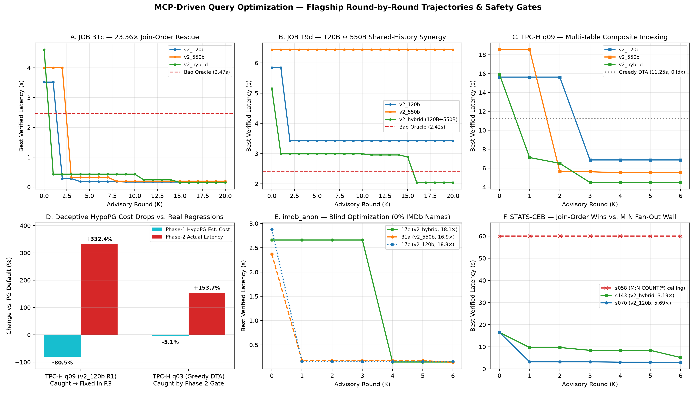

# Flagship Query Optimization Case Studies — Before vs. After Execution Plans

All latencies below come from the frozen `results/runs/*/queries.jsonl` logs, paired with live annotated PostgreSQL 16 `EXPLAIN (ANALYZE)` operator trees (`ExplainPlanArtifact` showing `AS` aliases and `[EST_ERR: Nx UNDER/OVER]` markers).



---

## Case Study 1: `JOB 31c` — Breaking the 49-Arm `Bao Oracle` Ceiling (`23.36×` Speedup)
- **Logged Latencies:** PostgreSQL Default `3537.4 ms` | 49-Arm `Bao Oracle` `2472.2 ms` | **`v2_hybrid` `151.4 ms` (`23.36×` vs. PG, `-93.9%` vs. Bao)**
- **Agent Diagnosis:** Try a genuinely different join order after the cn-mc-t prefix: join movie_keyword and keyword before cast_info and movie_info, avoiding the underestimated nested loops on ci/mi intermediates seen in the baseline.
- **Winning `pg_hint_plan` Block:** `/*+ Leading(cn mc t mk k ci mi mi_idx n it1 it2) HashJoin(cn mc) HashJoin(mc t) HashJoin(t mk) HashJoin(mk k) HashJoin(t ci) HashJoin(ci mi) HashJoin(mi mi_idx) HashJoin(ci n) HashJoin(mi it1) HashJoin(mi_idx it2) NoNestLoop(cn mc t mk k ci mi mi_idx n it1 it2) */`

### Default PostgreSQL 16 Execution Plan (Severe `[EST_ERR]` Nested-Loop Explosion)
```text
Planning Time: 37.447 ms
Execution Time: 3535.941 ms
→ Aggregate (Cost: 5924.47..5924.48) [EstRows: 1] [Actual: 3535.84..3535.84 ms, Rows: 1, Loops: 1]
  → Nested Loop (Cost: 3.45..5924.46) [EstRows: 1] [Actual: 23.09..3534.72 ms, Rows: 2825, Loops: 1] [EST_ERR: 2825x UNDER]
    → Nested Loop (Cost: 3.02..5923.95) [EstRows: 1] [Actual: 23.07..3530.59 ms, Rows: 2825, Loops: 1] [EST_ERR: 2825x UNDER]
      → Nested Loop (Cost: 2.60..5923.51) [EstRows: 1] [Actual: 0.85..3037.45 ms, Rows: 589677, Loops: 1] [EST_ERR: 589677x UNDER]
        → Nested Loop (Cost: 2.17..5922.93) [EstRows: 1] [Actual: 0.84..2909.16 ms, Rows: 42900, Loops: 1] [EST_ERR: 42900x UNDER]
          Join Filter: (mi.movie_id = t.id)
          → Nested Loop (Cost: 1.73..5922.46) [EstRows: 1] [Actual: 0.83..2852.10 ms, Rows: 42900, Loops: 1] [EST_ERR: 42900x UNDER]
            Join Filter: (ci.movie_id = mi.movie_id)
            → Nested Loop (Cost: 1.29..5921.04) [EstRows: 1] [Actual: 0.69..1033.87 ms, Rows: 63386, Loops: 1] [EST_ERR: 63386x UNDER]
              Join Filter: (it1.id = mi.info_type_id)
              → Seq Scan (Cost: 0.00..2.41) on info_type AS it1 [EstRows: 1] [Actual: 0.01..0.02 ms, Rows: 1, Loops: 1]
                Filter: ((info)::text = 'genres'::text)
              → Nested Loop (Cost: 1.29..5918.57) [EstRows: 4] [Actual: 0.68..1029.35 ms, Rows: 67732, Loops: 1] [EST_ERR: 16933x UNDER]
                Join Filter: (mi.movie_id = mi_idx.movie_id)
                → Nested Loop (Cost: 0.86..5909.18) [EstRows: 6] [Actual: 0.65..186.06 ms, Rows: 63701, Loops: 1] [EST_ERR: 10617x UNDER]
                  Join Filter: (it2.id = mi_idx.info_type_id)
                  → Seq Scan (Cost: 0.00..2.41) on info_type AS it2 [EstRows: 1] [Actual: 0.01..0.01 ms, Rows: 1, Loops: 1]
                    Filter: ((info)::text = 'votes'::text)
                  → Nested Loop (Cost: 0.86..5897.80) [EstRows: 717] [Actual: 0.64..177.59 ms, Rows: 191689, Loops: 1] [EST_ERR: 267x UNDER]
                    → Nested Loop (Cost: 0.43..5776.82) [EstRows: 236] [Actual: 0.64..60.97 ms, Rows: 76714, Loops: 1] [EST_ERR: 325x UNDER]
                      → Seq Scan (Cost: 0.00..3464.69) on keyword AS k [EstRows: 7] [Actual: 0.61..10.48 ms, Rows: 7, Loops: 1]
                        Filter: ((keyword)::text = ANY ('{murder,violence,blood,gore,death,female-nudity,hospital}'::text[]))
                      → Index Scan (Cost: 0.43..327.27) on movie_keyword AS mk using keyword_id_movie_keyword [EstRows: 304] [Actual: 0.01..6.57 ms, Rows: 10959, Loops: 7] [EST_ERR: 36x UNDER]
                        Index Cond: (keyword_id = k.id)
                    → Index Scan (Cost: 0.43..0.48) on movie_info_idx AS mi_idx using movie_id_movie_info_idx [EstRows: 3] [Actual: 0.00..0.00 ms, Rows: 2, Loops: 76714]
                      Index Cond: (movie_id = mk.movie_id)
                → Index Scan (Cost: 0.43..1.55) on movie_info AS mi using movie_id_movie_info [EstRows: 1] [Actual: 0.01..0.01 ms, Rows: 1, Loops: 63701]
                  Index Cond: (movie_id = mk.movie_id)
                  Filter: ((info)::text = ANY ('{Horror,Action,Sci-Fi,Thriller,Crime,War}'::text[]))
            → Index Scan (Cost: 0.44..1.41) on cast_info AS ci using movie_id_cast_info [EstRows: 1] [Actual: 0.02..0.03 ms, Rows: 1, Loops: 63386]
              Index Cond: (movie_id = mk.movie_id)
              Filter: ((note)::text = ANY ('{(writer),"(head writer)","(written by)",(story),"(story editor)"}'::text[]))
          → Index Scan (Cost: 0.43..0.46) on title AS t using title_pkey [EstRows: 1] [Actual: 0.00..0.00 ms, Rows: 1, Loops: 42900]
            Index Cond: (id = mk.movie_id)
        → Index Scan (Cost: 0.43..0.53) on movie_companies AS mc using movie_id_movie_companies [EstRows: 5] [Actual: 0.00..0.00 ms, Rows: 14, Loops: 42900]
          Index Cond: (movie_id = t.id)
      → Index Scan (Cost: 0.42..0.44) on company_name AS cn using company_name_pkey [EstRows: 1] [Actual: 0.00..0.00 ms, Rows: 0, Loops: 589677]
        Index Cond: (id = mc.company_id)
        Filter: ((name)::text ~~ 'Lionsgate%'::text)
    → Index Scan (Cost: 0.43..0.51) on name AS n using name_pkey [EstRows: 1] [Actual: 0.00..0.00 ms, Rows: 1, Loops: 2825]
      Index Cond: (id = ci.person_id)
```

### MCP-Steered Execution Plan (`151.4 ms`)
```text
Planning Time: 17.950 ms
Execution Time: 166.067 ms
→ Aggregate (Cost: 38928.66..38928.67) [EstRows: 1] [Actual: 165.86..165.97 ms, Rows: 1, Loops: 1]
  → Hash Join (Cost: 5728.68..38928.65) [EstRows: 1] [Actual: 18.69..165.43 ms, Rows: 2825, Loops: 1] [EST_ERR: 2825x UNDER]
    Hash Cond: (mi_idx.info_type_id = it2.id)
    → Nested Loop (Cost: 5726.25..38926.22) [EstRows: 1] [Actual: 18.67..164.83 ms, Rows: 8607, Loops: 1] [EST_ERR: 8607x UNDER]
      → Nested Loop (Cost: 5726.11..38926.04) [EstRows: 1] [Actual: 18.66..161.03 ms, Rows: 9205, Loops: 1] [EST_ERR: 9205x UNDER]
        → Nested Loop (Cost: 5725.68..38925.53) [EstRows: 1] [Actual: 18.65..154.44 ms, Rows: 9205, Loops: 1] [EST_ERR: 9205x UNDER]
          → Nested Loop (Cost: 5725.25..38925.01) [EstRows: 1] [Actual: 18.64..150.87 ms, Rows: 3009, Loops: 1] [EST_ERR: 3009x UNDER]
            Join Filter: (mi.movie_id = t.id)
            → Nested Loop (Cost: 5724.82..38923.44) [EstRows: 1] [Actual: 15.98..120.28 ms, Rows: 1472, Loops: 1] [EST_ERR: 1472x UNDER]
              Join Filter: (ci.movie_id = t.id)
              → Gather (Cost: 5724.38..38922.02) [EstRows: 1] [Actual: 15.90..47.09 ms, Rows: 1551, Loops: 1] [EST_ERR: 1551x UNDER]
                → Nested Loop (Cost: 4724.38..37921.92) [EstRows: 1] [Actual: 13.11..102.53 ms, Rows: 517, Loops: 3] [EST_ERR: 517x UNDER]
                  → Nested Loop (Cost: 4723.96..37503.00) [EstRows: 938] [Actual: 8.38..80.82 ms, Rows: 24240, Loops: 3] [EST_ERR: 26x UNDER]
                    → Nested Loop (Cost: 4723.52..37321.70) [EstRows: 106] [Actual: 7.51..76.21 ms, Rows: 605, Loops: 3]
                      → Hash Join (Cost: 4723.09..37272.26) [EstRows: 106] [Actual: 7.49..73.91 ms, Rows: 605, Loops: 3]
                        Hash Cond: (mc.company_id = cn.id)
                        → Seq Scan (Cost: 0.00..29695.37) on movie_companies AS mc [EstRows: 1087137] [Actual: 0.01..36.69 ms, Rows: 869710, Loops: 3]
                        → Hash (Cost: 4722.92..4722.92) [EstRows: 14] [Actual: 5.30..5.30 ms, Rows: 3, Loops: 3]
                          → Seq Scan (Cost: 0.00..4722.92) on company_name AS cn [EstRows: 14] [Actual: 2.41..5.25 ms, Rows: 3, Loops: 3]
                            Filter: ((name)::text ~~ 'Lionsgate%'::text)
                      → Index Scan (Cost: 0.43..0.47) on title AS t using title_pkey [EstRows: 1] [Actual: 0.00..0.00 ms, Rows: 1, Loops: 1814]
                        Index Cond: (id = mc.movie_id)
                    → Index Scan (Cost: 0.43..1.25) on movie_keyword AS mk using movie_id_movie_keyword [EstRows: 46] [Actual: 0.00..0.01 ms, Rows: 40, Loops: 1814]
                      Index Cond: (movie_id = t.id)
                  → Index Scan (Cost: 0.42..0.45) on keyword AS k using keyword_pkey [EstRows: 1] [Actual: 0.00..0.00 ms, Rows: 0, Loops: 72721]
                    Index Cond: (id = mk.keyword_id)
                    Filter: ((keyword)::text = ANY ('{murder,violence,blood,gore,death,female-nudity,hospital}'::text[]))
              → Index Scan (Cost: 0.44..1.41) on cast_info AS ci using movie_id_cast_info [EstRows: 1] [Actual: 0.04..0.05 ms, Rows: 1, Loops: 1551]
                Index Cond: (movie_id = mk.movie_id)
                Filter: ((note)::text = ANY ('{(writer),"(head writer)","(written by)",(story),"(story editor)"}'::text[]))
            → Index Scan (Cost: 0.43..1.55) on movie_info AS mi using movie_id_movie_info [EstRows: 1] [Actual: 0.02..0.02 ms, Rows: 2, Loops: 1472]
              Index Cond: (movie_id = mk.movie_id)
              Filter: ((info)::text = ANY ('{Horror,Action,Sci-Fi,Thriller,Crime,War}'::text[]))
          → Index Scan (Cost: 0.43..0.48) on movie_info_idx AS mi_idx using movie_id_movie_info_idx [EstRows: 3] [Actual: 0.00..0.00 ms, Rows: 3, Loops: 3009]
            Index Cond: (movie_id = t.id)
        → Index Scan (Cost: 0.43..0.51) on name AS n using name_pkey [EstRows: 1] [Actual: 0.00..0.00 ms, Rows: 1, Loops: 9205]
          Index Cond: (id = ci.person_id)
      → Index Scan (Cost: 0.14..0.16) on info_type AS it1 using info_type_pkey [EstRows: 1] [Actual: 0.00..0.00 ms, Rows: 1, Loops: 9205]
        Index Cond: (id = mi.info_type_id)
        Filter: ((info)::text = 'genres'::text)
    → Hash (Cost: 2.41..2.41) [EstRows: 1] [Actual: 0.01..0.01 ms, Rows: 1, Loops: 1]
      → Seq Scan (Cost: 0.00..2.41) on info_type AS it2 [EstRows: 1] [Actual: 0.01..0.01 ms, Rows: 1, Loops: 1]
        Filter: ((info)::text = 'votes'::text)
```

---

## Case Study 2: `JOB 19d` — Collaborative `120B ↔ 550B` Alternating Synergy
- **Logged Latencies:** Round-0 Baseline `5154.9 ms` | Standalone `v2_550b` `6,437.8 ms` (`1.00×`) | Standalone `v2_120b` `3,424.8 ms` | **`v2_hybrid` Round 1 (`120B`) `2992.5 ms` → Round `16` (`550B`) `2043.6 ms`** (beating `Bao Oracle`'s `2,421.0 ms`)
- **Round 1 (`120B` Worker) Foundation:** `/*+ NoNestLoop(ci t mc mi n an cn it rt chn) HashJoin(ci t) HashJoin(ci n) HashJoin(ci rt) HashJoin(ci an) HashJoin(ci chn) HashJoin(t mi) HashJoin(t mc) HashJoin(mc cn) HashJoin(mi it) Leading(ci t n rt an chn mi mc cn it) */`
- **Round `16` (`550B` Frontier) Refinement:** `/*+ Leading(ci rt n an chn t mi it mc cn) HashJoin(ci rt) HashJoin(ci n) HashJoin(n an) HashJoin(ci chn) HashJoin(ci t) HashJoin(t mi) HashJoin(mi it) HashJoin(t mc) HashJoin(mc cn) NoNestLoop(ci rt n an chn t mi it mc cn) */`
- **Frontier Diagnosis:** Start with cast_info (ci) as the central fact table filtered by note and role_id, join to small dimension tables rt and it early, then to title and movie_info, finally to company tables. This order prioritizes the most selective filters first and uses hash joins throughout to avoid nested loop underestimation.

### Default PostgreSQL 16 Execution Plan
```text
Planning Time: 14.561 ms
Execution Time: 5463.028 ms
→ Aggregate (Cost: 145455.30..145455.31) [EstRows: 1] [Actual: 5453.01..5453.01 ms, Rows: 1, Loops: 1]
  → Nested Loop (Cost: 3.45..145442.63) [EstRows: 2535] [Actual: 14.12..5340.06 ms, Rows: 1760645, Loops: 1] [EST_ERR: 695x UNDER]
    → Nested Loop (Cost: 3.02..144919.27) [EstRows: 1085] [Actual: 14.11..4804.90 ms, Rows: 787043, Loops: 1] [EST_ERR: 725x UNDER]
      → Nested Loop (Cost: 2.60..143595.24) [EstRows: 2998] [Actual: 14.10..2576.53 ms, Rows: 3229056, Loops: 1] [EST_ERR: 1077x UNDER]
        Join Filter: (mc.movie_id = t.id)
        → Nested Loop (Cost: 2.17..143252.58) [EstRows: 589] [Actual: 14.08..1896.07 ms, Rows: 341836, Loops: 1] [EST_ERR: 580x UNDER]
          Join Filter: (it.id = mi.info_type_id)
          → Seq Scan (Cost: 0.00..2.41) on info_type AS it [EstRows: 1] [Actual: 13.56..13.56 ms, Rows: 1, Loops: 1]
            Filter: ((info)::text = 'release dates'::text)
          → Nested Loop (Cost: 2.17..142418.54) [EstRows: 66530] [Actual: 0.51..1831.09 ms, Rows: 1622994, Loops: 1] [EST_ERR: 24x UNDER]
            → Nested Loop (Cost: 1.74..134963.11) [EstRows: 4234] [Actual: 0.48..1209.57 ms, Rows: 159307, Loops: 1] [EST_ERR: 38x UNDER]
              → Nested Loop (Cost: 1.31..131007.85) [EstRows: 7736] [Actual: 0.22..783.98 ms, Rows: 255493, Loops: 1] [EST_ERR: 33x UNDER]
                → Nested Loop (Cost: 0.88..113089.75) [EstRows: 32808] [Actual: 0.20..580.36 ms, Rows: 255651, Loops: 1]
                  → Nested Loop (Cost: 0.44..100889.55) [EstRows: 67332] [Actual: 0.17..442.21 ms, Rows: 276166, Loops: 1]
                    → Seq Scan (Cost: 0.00..1.15) on role_type AS rt [EstRows: 1] [Actual: 0.03..0.03 ms, Rows: 1, Loops: 1]
                      Filter: ((role)::text = 'actress'::text)
                    → Index Scan (Cost: 0.44..100153.88) on cast_info AS ci using role_id_cast_info [EstRows: 73453] [Actual: 0.14..429.60 ms, Rows: 276166, Loops: 1]
                      Index Cond: (role_id = rt.id)
                      Filter: ((note)::text = ANY ('{(voice),"(voice: Japanese version)","(voice) (uncredited)","(voice: Englis...
                  → Memoize (Cost: 0.44..0.47) [EstRows: 1] [Actual: 0.00..0.00 ms, Rows: 1, Loops: 276166]
                    → Index Only Scan (Cost: 0.43..0.46) on char_name AS chn using char_name_pkey [EstRows: 1] [Actual: 0.00..0.00 ms, Rows: 1, Loops: 47388]
                      Index Cond: (id = ci.person_role_id)
                → Index Scan (Cost: 0.43..0.55) on name AS n using name_pkey [EstRows: 1] [Actual: 0.00..0.00 ms, Rows: 1, Loops: 255651]
                  Index Cond: (id = ci.person_id)
                  Filter: ((gender)::text = 'f'::text)
              → Index Scan (Cost: 0.43..0.51) on title AS t using title_pkey [EstRows: 1] [Actual: 0.00..0.00 ms, Rows: 1, Loops: 255493]
                Index Cond: (id = ci.movie_id)
                Filter: (production_year > 2000)
            → Index Scan (Cost: 0.43..1.33) on movie_info AS mi using movie_id_movie_info [EstRows: 43] [Actual: 0.00..0.00 ms, Rows: 10, Loops: 159307]
              Index Cond: (movie_id = t.id)
        → Index Scan (Cost: 0.43..0.52) on movie_companies AS mc using movie_id_movie_companies [EstRows: 5] [Actual: 0.00..0.00 ms, Rows: 9, Loops: 341836]
          Index Cond: (movie_id = mi.movie_id)
      → Index Scan (Cost: 0.42..0.44) on company_name AS cn using company_name_pkey [EstRows: 1] [Actual: 0.00..0.00 ms, Rows: 0, Loops: 3229056]
        Index Cond: (id = mc.company_id)
        Filter: ((country_code)::text = '[us]'::text)
    → Index Only Scan (Cost: 0.42..0.46) on aka_name AS an using person_id_aka_name [EstRows: 2] [Actual: 0.00..0.00 ms, Rows: 2, Loops: 787043]
      Index Cond: (person_id = n.id)
```

### Alternating Hybrid Refined Execution Plan (`2043.6 ms`)
```text
Planning Time: 11.159 ms
Execution Time: 2100.492 ms
→ Aggregate (Cost: 524019.03..524019.04) [EstRows: 1] [Actual: 2047.91..2087.84 ms, Rows: 1, Loops: 1]
  → Gather (Cost: 524018.81..524019.02) [EstRows: 2] [Actual: 2047.63..2087.82 ms, Rows: 3, Loops: 1]
    → Aggregate (Cost: 523018.81..523018.82) [EstRows: 1] [Actual: 2035.55..2035.56 ms, Rows: 1, Loops: 3]
      → Hash Join (Cost: 5354.31..523013.53) [EstRows: 1056] [Actual: 368.70..1993.17 ms, Rows: 586882, Loops: 3] [EST_ERR: 556x UNDER]
        Hash Cond: (mc.company_id = cn.id)
        → Nested Loop (Cost: 6.17..517657.73) [EstRows: 2919] [Actual: 157.08..1672.49 ms, Rows: 2007897, Loops: 3] [EST_ERR: 688x UNDER]
          Join Filter: (mc.movie_id = t.id)
          → Hash Join (Cost: 5.74..517324.37) [EstRows: 573] [Actual: 157.02..1282.78 ms, Rows: 234331, Loops: 3] [EST_ERR: 409x UNDER]
            Hash Cond: (mi.info_type_id = it.id)
            → Nested Loop (Cost: 3.31..517145.53) [EstRows: 64778] [Actual: 156.97..1233.21 ms, Rows: 1157133, Loops: 3] [EST_ERR: 18x UNDER]
              → Nested Loop (Cost: 2.88..509887.31) [EstRows: 4122] [Actual: 156.95..959.48 ms, Rows: 96766, Loops: 3] [EST_ERR: 23x UNDER]
                → Nested Loop (Cost: 2.45..506036.36) [EstRows: 7532] [Actual: 156.91..788.79 ms, Rows: 160947, Loops: 3] [EST_ERR: 21x UNDER]
                  → Nested Loop (Cost: 2.02..498881.98) [EstRows: 15459] [Actual: 156.89..672.82 ms, Rows: 167674, Loops: 3] [EST_ERR: 11x UNDER]
                    → Nested Loop (Cost: 1.59..495691.15) [EstRows: 6615] [Actual: 156.75..603.26 ms, Rows: 92002, Loops: 3] [EST_ERR: 14x UNDER]
                      → Hash Join (Cost: 1.16..480368.90) [EstRows: 28055] [Actual: 156.71..523.97 ms, Rows: 92055, Loops: 3]
                        Hash Cond: (ci.role_id = rt.id)
                        → Seq Scan (Cost: 0.00..479171.90) on cast_info AS ci [EstRows: 336658] [Actual: 0.01..508.65 ms, Rows: 289159, Loops: 3]
                          Filter: ((note)::text = ANY ('{(voice),"(voice: Japanese version)","(voice) (uncredited)","(voice: Englis...
                        → Hash (Cost: 1.15..1.15) [EstRows: 1] [Actual: 0.01..0.01 ms, Rows: 1, Loops: 3]
                          → Seq Scan (Cost: 0.00..1.15) on role_type AS rt [EstRows: 1] [Actual: 0.01..0.01 ms, Rows: 1, Loops: 3]
                            Filter: ((role)::text = 'actress'::text)
                      → Index Scan (Cost: 0.43..0.55) on name AS n using name_pkey [EstRows: 1] [Actual: 0.00..0.00 ms, Rows: 1, Loops: 276166]
                        Index Cond: (id = ci.person_id)
                        Filter: ((gender)::text = 'f'::text)
                    → Index Only Scan (Cost: 0.42..0.46) on aka_name AS an using person_id_aka_name [EstRows: 2] [Actual: 0.00..0.00 ms, Rows: 2, Loops: 276005]
                      Index Cond: (person_id = n.id)
                  → Index Only Scan (Cost: 0.43..0.46) on char_name AS chn using char_name_pkey [EstRows: 1] [Actual: 0.00..0.00 ms, Rows: 1, Loops: 503022]
                    Index Cond: (id = ci.person_role_id)
                → Index Scan (Cost: 0.43..0.51) on title AS t using title_pkey [EstRows: 1] [Actual: 0.00..0.00 ms, Rows: 1, Loops: 482841]
                  Index Cond: (id = ci.movie_id)
                  Filter: (production_year > 2000)
              → Index Scan (Cost: 0.43..1.33) on movie_info AS mi using movie_id_movie_info [EstRows: 43] [Actual: 0.00..0.00 ms, Rows: 12, Loops: 290297]
                Index Cond: (movie_id = t.id)
            → Hash (Cost: 2.41..2.41) [EstRows: 1] [Actual: 0.03..0.03 ms, Rows: 1, Loops: 3]
              → Seq Scan (Cost: 0.00..2.41) on info_type AS it [EstRows: 1] [Actual: 0.03..0.03 ms, Rows: 1, Loops: 3]
                Filter: ((info)::text = 'release dates'::text)
          → Index Scan (Cost: 0.43..0.52) on movie_companies AS mc using movie_id_movie_companies [EstRows: 5] [Actual: 0.00..0.00 ms, Rows: 9, Loops: 702993]
            Index Cond: (movie_id = mi.movie_id)
        → Hash (Cost: 4722.92..4722.92) [EstRows: 50018] [Actual: 211.31..211.31 ms, Rows: 28281, Loops: 3]
          → Seq Scan (Cost: 0.00..4722.92) on company_name AS cn [EstRows: 50018] [Actual: 199.06..204.17 ms, Rows: 28281, Loops: 3]
            Filter: ((country_code)::text = '[us]'::text)
```

---

## Case Study 3: `TPC-H SF=10 q17` — Timeout Rescue via 2-Phase Indexing (`180,000.0 ms → 16.6 ms`)
- **Logged Latencies:** PostgreSQL Default `180,000.0 ms` (Timed Out) | **`v2_hybrid` `16.6 ms`** (Phase-2 index build `[1926.85, 26768.97] ms` on `tpch_eval`)
- **Winning Composite Index Spec:** `[{"table": "part", "columns": ["p_container", "p_brand", "p_partkey"], "using": "btree"}, {"table": "lineitem", "columns": ["l_partkey", "l_quantity", "l_extendedprice"], "using": "btree"}]`

### Default PostgreSQL 16 Estimated Plan (Correlated `Seq Scan` on 60M-Row `lineitem`)
```text
→ Aggregate (Cost: 20465555.86..20465555.87) [EstRows: 1]
  → Hash Join (Cost: 51917.71..20465503.72) [EstRows: 20856]
    Hash Cond: (lineitem.l_partkey = part.p_partkey)
    → Seq Scan (Cost: 0.00..1705125.40) on lineitem [EstRows: 59989340]
    → Hash (Cost: 51891.64..51891.64) [EstRows: 2086]
      → Gather (Cost: 1000.00..51891.64) [EstRows: 2086]
        → Seq Scan (Cost: 0.00..50683.04) on part [EstRows: 869]
          Filter: (((p_brand)::text = 'Brand#23'::text) AND ((p_container)::text = 'MED BOX'::text))
    → Aggregate (Cost: 1855098.83..1855098.84) [EstRows: 1]
      → Seq Scan (Cost: 0.00..1855098.75) on lineitem AS lineitem_1 [EstRows: 32]
        Filter: (l_partkey = part.p_partkey)
```

### Phase-2 Verified Execution Plan on `tpch_eval` (`16.6 ms`)
```text
Planning Time: 0.157 ms
Execution Time: 15.819 ms
→ Aggregate (Cost: 12025.57..12025.58) [EstRows: 1] [Actual: 15.77..15.77 ms, Rows: 1, Loops: 1]
  → Nested Loop (Cost: 4.41..11970.56) [EstRows: 22001] [Actual: 0.03..15.54 ms, Rows: 5526, Loops: 1]
    → Index Only Scan (Cost: 0.43..58.75) on part using tmp_adv_idx_1795623664323_0 [EstRows: 2201] [Actual: 0.01..0.16 ms, Rows: 2044, Loops: 1]
      Index Cond: ((p_container = 'MED BOX'::text) AND (p_brand = 'Brand#23'::text))
    → Index Only Scan (Cost: 3.98..5.30) on lineitem using tmp_adv_idx_1795623666250_1 [EstRows: 11] [Actual: 0.00..0.00 ms, Rows: 3, Loops: 2044]
      Index Cond: ((l_partkey = part.p_partkey) AND (l_quantity < (SubPlan 1)))
      → Aggregate (Cost: 3.41..3.42) [EstRows: 1] [Actual: 0.01..0.01 ms, Rows: 1, Loops: 2044]
        → Index Only Scan (Cost: 0.56..3.33) on lineitem AS lineitem_1 using tmp_adv_idx_1795623666250_1 [EstRows: 32] [Actual: 0.00..0.01 ms, Rows: 30, Loops: 2044]
          Index Cond: (l_partkey = part.p_partkey)
```

---

## Case Study 4: `TPC-H SF=10 q03` & `q09` — Why Phase-2 Real Materialization Is Mandatory
- **Frozen Official Evidence (`dta_tpch_top8_v2` `q03`):** Classical `DTA` proposed `[{"table": "orders", "columns": ["o_custkey"], "using": "btree"}]` because `HypoPG` estimated a cost reduction from `2475759.8` → `2349811.0` (**`-5.1%`**). Yet Phase-2 timing on `tpch_eval` revealed a **`+153.7%` real latency regression** (`2920.1 ms` → `7407.3 ms`, caught and blocked by our Phase-2 gate). Similarly, on `q09` Round 1 (`v2_120b_tpch_top8_k6`), `HypoPG` predicted `-80.5%` cost while real latency regressed `+332.4%` (`15,631.6 ms → 67,588.6 ms`), prompting the agent to pivot in Round 3 to a verified `6,863.7 ms` (`2.28×`) composite index set.
- **Root Cause:** Replacing a fast Parallel `Seq Scan` + `Hash Join` with scattered B-tree heap fetches across millions of `orders` rows loses to sequential scan bandwidth despite lower planner cost units.

### Default Parallel Plan on `TPC-H q03` (`2920.1 ms`)
```text
Planning Time: 11.382 ms
Execution Time: 9008.251 ms
→ Limit (Cost: 2475759.80..2475759.82) [EstRows: 10] [Actual: 8948.53..8955.44 ms, Rows: 10, Loops: 1]
  → Sort (Cost: 2475759.80..2483716.64) [EstRows: 3182736] [Actual: 8804.06..8810.98 ms, Rows: 10, Loops: 1] [EST_ERR: 318274x OVER]
    → Aggregate (Cost: 2320575.71..2406982.02) [EstRows: 3182736] [Actual: 8775.69..8802.37 ms, Rows: 114003, Loops: 1] [EST_ERR: 28x OVER]
      → Gather (Cost: 1901287.54..2183092.29) [EstRows: 2652280] [Actual: 8711.31..8742.37 ms, Rows: 114018, Loops: 1] [EST_ERR: 23x OVER]
        → Aggregate (Cost: 1900287.54..1916864.29) [EstRows: 1326140] [Actual: 8693.86..8704.99 ms, Rows: 38006, Loops: 3] [EST_ERR: 35x OVER]
          → Hash Join (Cost: 406741.07..1880395.44) [EstRows: 1326140] [Actual: 2346.97..8595.76 ms, Rows: 100705, Loops: 3] [EST_ERR: 13x OVER]
            Hash Cond: (lineitem.l_orderkey = orders.o_orderkey)
            → Seq Scan (Cost: 0.00..1417676.48) on lineitem [EstRows: 13453947] [Actual: 0.31..5277.79 ms, Rows: 10778083, Loops: 3]
              Filter: (l_shipdate > '1995-03-15'::date)
            → Hash (Cost: 399040.49..399040.49) [EstRows: 616046] [Actual: 2344.27..2344.45 ms, Rows: 487308, Loops: 3]
              → Hash Join (Cost: 45885.09..399040.49) [EstRows: 616046] [Actual: 446.44..2224.83 ms, Rows: 487308, Loops: 3]
                Hash Cond: (orders.o_custkey = customer.c_custkey)
                → Seq Scan (Cost: 0.00..345195.80) on orders [EstRows: 3032222] [Actual: 0.40..1371.39 ms, Rows: 2429814, Loops: 3]
                  Filter: (o_orderdate < '1995-03-15'::date)
                → Hash (Cost: 44297.79..44297.79) [EstRows: 126984] [Actual: 445.57..445.57 ms, Rows: 100092, Loops: 3]
                  → Seq Scan (Cost: 0.00..44297.79) on customer [EstRows: 126984] [Actual: 87.71..426.83 ms, Rows: 100092, Loops: 3]
                    Filter: ((c_mktsegment)::text = 'BUILDING'::text)
```

### Regressing Indexed Plan Caught in Phase 2 (`7407.3 ms`, Rejected by Regression Gate)
```text
Planning Time: 5.005 ms
Execution Time: 11053.460 ms
→ Limit (Cost: 2344854.07..2344854.10) [EstRows: 10] [Actual: 10978.06..10984.93 ms, Rows: 10, Loops: 1]
  → Sort (Cost: 2344854.07..2352650.75) [EstRows: 3118670] [Actual: 10882.60..10889.47 ms, Rows: 10, Loops: 1] [EST_ERR: 311867x OVER]
    → Aggregate (Cost: 2192793.71..2277460.74) [EstRows: 3118670] [Actual: 10851.10..10880.26 ms, Rows: 114003, Loops: 1] [EST_ERR: 27x OVER]
      → Gather (Cost: 1781945.43..2058077.71) [EstRows: 2598892] [Actual: 10778.84..10813.42 ms, Rows: 114008, Loops: 1] [EST_ERR: 23x OVER]
        → Aggregate (Cost: 1780945.43..1797188.51) [EstRows: 1299446] [Actual: 10744.39..10757.45 ms, Rows: 38003, Loops: 3] [EST_ERR: 34x OVER]
          → Hash Join (Cost: 287490.43..1761453.74) [EstRows: 1299446] [Actual: 1176.82..10630.20 ms, Rows: 100705, Loops: 3] [EST_ERR: 13x OVER]
            Hash Cond: (lineitem.l_orderkey = orders.o_orderkey)
            → Seq Scan (Cost: 0.00..1417674.75) on lineitem [EstRows: 13566455] [Actual: 0.20..8385.16 ms, Rows: 10778083, Loops: 3]
              Filter: (l_shipdate > '1995-03-15'::date)
            → Hash (Cost: 280006.40..280006.40) [EstRows: 598722] [Actual: 1173.55..1173.78 ms, Rows: 487308, Loops: 3]
              → Nested Loop (Cost: 0.43..280006.40) [EstRows: 598722] [Actual: 80.49..1076.32 ms, Rows: 487308, Loops: 3]
                → Seq Scan (Cost: 0.00..44297.19) on customer [EstRows: 124266] [Actual: 80.36..181.95 ms, Rows: 100092, Loops: 3]
                  Filter: ((c_mktsegment)::text = 'BUILDING'::text)
                → Index Scan (Cost: 0.43..1.82) on orders using tmp_adv_idx_1795624003238_0 [EstRows: 8] [Actual: 0.00..0.01 ms, Rows: 5, Loops: 300276]
                  Index Cond: (o_custkey = customer.c_custkey)
                  Filter: (o_orderdate < '1995-03-15'::date)
```

---

## Case Study 5: `imdb_anon 17c` — Blind Optimization With Zero IMDb Identifiers (`18.13×`)
- **Logged Latencies:** Baseline `2660.5 ms` → **`v2_hybrid` `146.8 ms` (`18.13×`)**
- **Winning Blind `pg_hint_plan` Block:** `/*+ Leading(a06 a01 a05 a03 a04 a07 a02) HashJoin(a06 a01 a05 a03 a04 a07 a02) SeqScan(a06) SeqScan(a03) */`
- **Agent Diagnosis (Purely From Anonymized `t01..t21` `EXPLAIN ANALYZE` & `[EST_ERR]` — Zero Schema Names, Zero `pg_stats`):** Start with the two highly selective filters (a06.c02 LIKE 'X%' ~174 rows, a03.c02='character-name-in-title' 1 row), force hash joins for all subsequent large intermediate joins to avoid catastrophic nested-loop underestimation, and use sequential scans on filtered tables.

### Anonymized SQL Query (`benchmarks/imdb_anon/queries/17c.sql`)
```sql
SELECT MIN(a06.c02) AS out_01,
       MIN(a06.c02) AS out_02
FROM
    t03 AS a01,
    t06 AS a02,
    t10 AS a03,
    t13 AS a04,
    t16 AS a05,
    t18 AS a06,
    t21 AS a07
WHERE a03.c02 ='character-name-in-title'
  AND a06.c02 LIKE 'X%'
  AND a06.c01 = a01.c02
  AND a01.c03 = a07.c01
  AND a07.c01 = a05.c02
  AND a05.c03 = a03.c01
  AND a07.c01 = a04.c02
  AND a04.c03 = a02.c01
  AND a01.c03 = a04.c02
  AND a01.c03 = a05.c02
  AND a04.c02 = a05.c02;
```

### Default vs. MCP-Steered Plan on `imdb_anon`
```text
--- BEFORE (2660.5 ms) ---
Planning Time: 2.649 ms
Execution Time: 2733.664 ms
→ Aggregate (Cost: 3608.11..3608.12) [EstRows: 1] [Actual: 2733.60..2733.60 ms, Rows: 1, Loops: 1]
  → Nested Loop (Cost: 2.58..3608.11) [EstRows: 1] [Actual: 19.68..2733.08 ms, Rows: 1918, Loops: 1] [EST_ERR: 1918x UNDER]
    → Nested Loop (Cost: 2.15..3607.66) [EstRows: 1] [Actual: 19.67..2731.53 ms, Rows: 1918, Loops: 1] [EST_ERR: 1918x UNDER]
      → Nested Loop (Cost: 1.73..3607.22) [EstRows: 1] [Actual: 19.66..2728.66 ms, Rows: 1918, Loops: 1] [EST_ERR: 1918x UNDER]
        → Nested Loop (Cost: 1.30..3606.66) [EstRows: 1] [Actual: 19.65..2727.50 ms, Rows: 250, Loops: 1] [EST_ERR: 250x UNDER]
          → Nested Loop (Cost: 0.87..3022.03) [EstRows: 1293] [Actual: 0.20..807.14 ms, Rows: 1038393, Loops: 1] [EST_ERR: 803x UNDER]
            → Nested Loop (Cost: 0.43..2969.15) [EstRows: 34] [Actual: 0.19..20.46 ms, Rows: 41840, Loops: 1] [EST_ERR: 1231x UNDER]
              → Seq Scan (Cost: 0.00..2626.12) on t10 AS a03 [EstRows: 1] [Actual: 0.18..3.46 ms, Rows: 1, Loops: 1]
                Filter: ((c02)::text = 'character-name-in-title'::text)
              → Index Scan (Cost: 0.43..339.99) on t16 AS a05 using idx_15 [EstRows: 304] [Actual: 0.01..14.52 ms, Rows: 41840, Loops: 1] [EST_ERR: 138x UNDER]
                Index Cond: (c03 = a03.c01)
            → Index Scan (Cost: 0.44..1.18) on t03 AS a01 using idx_25 [EstRows: 38] [Actual: 0.00..0.02 ms, Rows: 25, Loops: 41840]
              Index Cond: (c03 = a05.c02)
          → Index Scan (Cost: 0.43..0.45) on t18 AS a06 using idx_36 [EstRows: 1] [Actual: 0.00..0.00 ms, Rows: 0, Loops: 1038393]
            Index Cond: (c01 = a01.c02)
            Filter: ((c02)::text ~~ 'X%'::text)
        → Index Scan (Cost: 0.43..0.52) on t13 AS a04 using idx_27 [EstRows: 5] [Actual: 0.00..0.00 ms, Rows: 8, Loops: 250]
          Index Cond: (c02 = a01.c03)
      → Index Only Scan (Cost: 0.42..0.44) on t06 AS a02 using idx_07 [EstRows: 1] [Actual: 0.00..0.00 ms, Rows: 1, Loops: 1918]
        Index Cond: (c01 = a04.c03)
    → Index Only Scan (Cost: 0.43..0.45) on t21 AS a07 using idx_44 [EstRows: 1] [Actual: 0.00..0.00 ms, Rows: 1, Loops: 1918]
      Index Cond: (c01 = a01.c03)

--- AFTER (146.8 ms) ---
Planning Time: 3.363 ms
Execution Time: 142.352 ms
→ Aggregate (Cost: 125095.93..125095.94) [EstRows: 1] [Actual: 115.38..132.30 ms, Rows: 1, Loops: 1]
  → Gather (Cost: 121603.20..125095.93) [EstRows: 1] [Actual: 107.64..132.16 ms, Rows: 1918, Loops: 1] [EST_ERR: 1918x UNDER]
    → Hash Join (Cost: 120603.20..124095.83) [EstRows: 1] [Actual: 100.11..107.62 ms, Rows: 639, Loops: 3] [EST_ERR: 639x UNDER]
      Hash Cond: (a02.c01 = a04.c03)
      → Index Only Scan (Cost: 0.42..3125.86) on t06 AS a02 using idx_07 [EstRows: 97915] [Actual: 0.05..3.85 ms, Rows: 78332, Loops: 3]
      → Hash (Cost: 120602.77..120602.77) [EstRows: 1] [Actual: 99.90..99.91 ms, Rows: 639, Loops: 3] [EST_ERR: 639x UNDER]
        → Nested Loop (Cost: 2627.87..120602.77) [EstRows: 1] [Actual: 53.85..99.78 ms, Rows: 639, Loops: 3] [EST_ERR: 639x UNDER]
          → Nested Loop (Cost: 2627.44..120602.32) [EstRows: 1] [Actual: 53.83..99.21 ms, Rows: 639, Loops: 3] [EST_ERR: 639x UNDER]
            → Hash Join (Cost: 2627.01..120601.75) [EstRows: 1] [Actual: 53.81..98.77 ms, Rows: 83, Loops: 3] [EST_ERR: 83x UNDER]
              Hash Cond: (a05.c03 = a03.c01)
              → Nested Loop (Cost: 0.87..117948.47) [EstRows: 7234] [Actual: 42.34..94.10 ms, Rows: 21085, Loops: 3]
                → Nested Loop (Cost: 0.44..115383.90) [EstRows: 1510] [Actual: 42.26..85.84 ms, Rows: 4167, Loops: 3]
                  → Seq Scan (Cost: 0.00..77319.75) on t18 AS a06 [EstRows: 174] [Actual: 42.21..84.37 ms, Rows: 888, Loops: 3]
                    Filter: ((c02)::text ~~ 'X%'::text)
                  → Index Scan (Cost: 0.44..213.70) on t03 AS a01 using idx_38 [EstRows: 506] [Actual: 0.00..0.00 ms, Rows: 5, Loops: 2664] [EST_ERR: 101x OVER]
                    Index Cond: (c02 = a06.c01)
                → Index Scan (Cost: 0.43..1.24) on t16 AS a05 using idx_30 [EstRows: 46] [Actual: 0.00..0.00 ms, Rows: 5, Loops: 12500]
                  Index Cond: (c02 = a01.c03)
              → Hash (Cost: 2626.12..2626.12) [EstRows: 1] [Actual: 3.91..3.91 ms, Rows: 1, Loops: 3]
                → Seq Scan (Cost: 0.00..2626.12) on t10 AS a03 [EstRows: 1] [Actual: 0.21..3.90 ms, Rows: 1, Loops: 3]
                  Filter: ((c02)::text = 'character-name-in-title'::text)
            → Index Scan (Cost: 0.43..0.52) on t13 AS a04 using idx_27 [EstRows: 5] [Actual: 0.00..0.01 ms, Rows: 8, Loops: 250]
              Index Cond: (c02 = a01.c03)
          → Index Only Scan (Cost: 0.43..0.45) on t21 AS a07 using idx_44 [EstRows: 1] [Actual: 0.00..0.00 ms, Rows: 1, Loops: 1918]
            Index Cond: (c01 = a01.c03)
```

---

## Case Study 6: `STATS-CEB s070` — Unseen Real-World Generalization (`5.69×`)
- **Logged Latencies:** Baseline `16557.5 ms` → **`v2_120b` `2911.6 ms` (`5.69×`)**
- **Winning `pg_hint_plan` Block:** `/*+ Leading(c p pl v ph b) HashJoin(c p) HashJoin(p pl) HashJoin(p v) HashJoin(p ph) HashJoin(c b) NoNestLoop(c p pl v ph b) */`
- **Agent Diagnosis:** Try a new join order placing postLinks (pl) immediately after posts (p) before votes (v), which differs from all previous leading orders and may reduce intermediate row explosion by joining the small postLinks table earlier.

```sql
SELECT COUNT(*) FROM comments as c, posts as p, postLinks as pl, postHistory as ph, votes as v, badges as b WHERE p.Id = c.PostId AND p.Id = pl.RelatedPostId AND p.Id = ph.PostId AND p.Id = v.PostId AND b.UserId = c.UserId AND c.CreationDate>='2010-07-26 20:21:15'::timestamp AND c.CreationDate<='2014-09-13 18:12:10'::timestamp AND p.Score<=61 AND p.ViewCount<=3627 AND p.AnswerCount>=0 AND p.AnswerCount<=5 AND p.CommentCount<=8 AND p.FavoriteCount>=0 AND v.VoteTypeId=2 AND v.CreationDate>='2010-07-27 00:00:00'::timestamp AND b.Date>='2010-07-30 03:49:24'::timestamp;
```

```text
--- BEFORE (16557.5 ms) ---
Planning Time: 1.738 ms
Execution Time: 14440.290 ms
→ Aggregate (Cost: 7987.52..7987.53) [EstRows: 1] [Actual: 14440.15..14440.15 ms, Rows: 1, Loops: 1]
  → Nested Loop (Cost: 1.86..6793.36) [EstRows: 477664] [Actual: 0.09..12487.10 ms, Rows: 80052528, Loops: 1] [EST_ERR: 168x UNDER]
    → Nested Loop (Cost: 1.57..4395.33) [EstRows: 5763] [Actual: 0.07..236.94 ms, Rows: 682253, Loops: 1] [EST_ERR: 118x UNDER]
      Join Filter: (p.id = ph.postid)
      → Nested Loop (Cost: 1.15..3390.09) [EstRows: 1749] [Actual: 0.06..103.85 ms, Rows: 97802, Loops: 1] [EST_ERR: 56x UNDER]
        Join Filter: (p.id = v.postid)
        → Nested Loop (Cost: 0.72..2963.04) [EstRows: 615] [Actual: 0.05..41.17 ms, Rows: 11134, Loops: 1] [EST_ERR: 18x UNDER]
          Join Filter: (c.postid = p.id)
          → Nested Loop (Cost: 0.30..2714.48) [EstRows: 328] [Actual: 0.03..23.86 ms, Rows: 4664, Loops: 1] [EST_ERR: 14x UNDER]
            → Seq Scan (Cost: 0.00..193.02) on postlinks AS pl [EstRows: 11102] [Actual: 0.00..1.13 ms, Rows: 11102, Loops: 1]
            → Memoize (Cost: 0.30..0.44) [EstRows: 1] [Actual: 0.00..0.00 ms, Rows: 0, Loops: 11102]
              → Index Scan (Cost: 0.29..0.43) on posts AS p using posts_pkey [EstRows: 1] [Actual: 0.00..0.00 ms, Rows: 0, Loops: 5177]
                Index Cond: (id = pl.relatedpostid)
                Filter: ((score <= 61) AND (viewcount <= 3627) AND (answercount >= 0) AND (answercount <= 5) AND (comment...
          → Index Scan (Cost: 0.42..0.70) on comments AS c using idx_comments_postid [EstRows: 5] [Actual: 0.00..0.00 ms, Rows: 2, Loops: 4664]
            Index Cond: (postid = pl.relatedpostid)
            Filter: ((creationdate >= '2010-07-26 20:21:15'::timestamp without time zone) AND (creationdate <= '2014-...
        → Index Scan (Cost: 0.42..0.62) on votes AS v using idx_votes_postid [EstRows: 6] [Actual: 0.00..0.01 ms, Rows: 9, Loops: 11134]
          Index Cond: (postid = c.postid)
          Filter: ((creationdate >= '2010-07-27 00:00:00'::timestamp without time zone) AND (votetypeid = 2))
      → Index Only Scan (Cost: 0.42..0.51) on posthistory AS ph using idx_posthistory_postid [EstRows: 5] [Actual: 0.00..0.00 ms, Rows: 7, Loops: 97802]
        Index Cond: (postid = v.postid)
    → Index Scan (Cost: 0.29..0.38) on badges AS b using idx_badges_userid [EstRows: 4] [Actual: 0.00..0.01 ms, Rows: 117, Loops: 682253] [EST_ERR: 29x UNDER]
      Index Cond: (userid = c.userid)
      Filter: (date >= '2010-07-30 03:49:24'::timestamp without time zone)

--- AFTER (2911.6 ms) ---
Planning Time: 2.993 ms
Execution Time: 2563.550 ms
→ Aggregate (Cost: 16698.54..16698.55) [EstRows: 1] [Actual: 2561.31..2563.41 ms, Rows: 1, Loops: 1]
  → Gather (Cost: 16698.43..16698.54) [EstRows: 1] [Actual: 2561.31..2563.41 ms, Rows: 2, Loops: 1]
    → Aggregate (Cost: 15698.43..15698.44) [EstRows: 1] [Actual: 2559.92..2559.93 ms, Rows: 1, Loops: 2]
      → Hash Join (Cost: 5922.14..14995.98) [EstRows: 280979] [Actual: 15.25..1616.39 ms, Rows: 40026264, Loops: 2] [EST_ERR: 142x UNDER]
        Hash Cond: (c.userid = b.userid)
        → Nested Loop (Cost: 3506.00..7867.42) [EstRows: 3390] [Actual: 6.68..112.95 ms, Rows: 341126, Loops: 2] [EST_ERR: 101x UNDER]
          Join Filter: (p.id = ph.postid)
          → Nested Loop (Cost: 3505.58..7276.00) [EstRows: 1029] [Actual: 6.67..48.27 ms, Rows: 48901, Loops: 2] [EST_ERR: 48x UNDER]
            Join Filter: (p.id = v.postid)
            → Hash Join (Cost: 3505.16..7024.63) [EstRows: 362] [Actual: 6.65..20.75 ms, Rows: 5567, Loops: 2] [EST_ERR: 15x UNDER]
              Hash Cond: (p.id = pl.relatedpostid)
              → Hash Join (Cost: 3173.36..6321.83) [EstRows: 2999] [Actual: 5.42..17.75 ms, Rows: 11106, Loops: 2]
                Hash Cond: (c.postid = p.id)
                → Seq Scan (Cost: 0.00..2881.99) on comments AS c [EstRows: 101514] [Actual: 0.01..5.13 ms, Rows: 86860, Loops: 2]
                  Filter: ((creationdate >= '2010-07-26 20:21:15'::timestamp without time zone) AND (creationdate <= '2014-...
                → Hash (Cost: 3139.40..3139.40) [EstRows: 2717] [Actual: 5.39..5.39 ms, Rows: 11552, Loops: 2]
                  → Seq Scan (Cost: 0.00..3139.40) on posts AS p [EstRows: 2717] [Actual: 0.01..4.73 ms, Rows: 11552, Loops: 2]
                    Filter: ((score <= 61) AND (viewcount <= 3627) AND (answercount >= 0) AND (answercount <= 5) AND (comment...
              → Hash (Cost: 193.02..193.02) [EstRows: 11102] [Actual: 1.20..1.20 ms, Rows: 11102, Loops: 2]
                → Seq Scan (Cost: 0.00..193.02) on postlinks AS pl [EstRows: 11102] [Actual: 0.01..0.62 ms, Rows: 11102, Loops: 2]
            → Index Scan (Cost: 0.42..0.62) on votes AS v using idx_votes_postid [EstRows: 6] [Actual: 0.00..0.00 ms, Rows: 9, Loops: 11134]
              Index Cond: (postid = c.postid)
              Filter: ((creationdate >= '2010-07-27 00:00:00'::timestamp without time zone) AND (votetypeid = 2))
          → Index Only Scan (Cost: 0.42..0.51) on posthistory AS ph using idx_posthistory_postid [EstRows: 5] [Actual: 0.00..0.00 ms, Rows: 7, Loops: 97802]
            Index Cond: (postid = v.postid)
        → Hash (Cost: 1430.14..1430.14) [EstRows: 78880] [Actual: 8.31..8.31 ms, Rows: 78900, Loops: 2]
          → Seq Scan (Cost: 0.00..1430.14) on badges AS b [EstRows: 78880] [Actual: 0.04..3.85 ms, Rows: 78900, Loops: 2]
            Filter: (date >= '2010-07-30 03:49:24'::timestamp without time zone)
```
