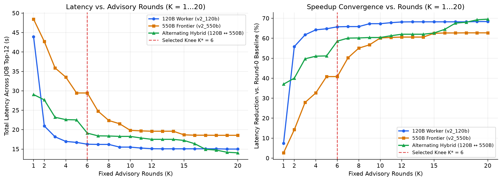
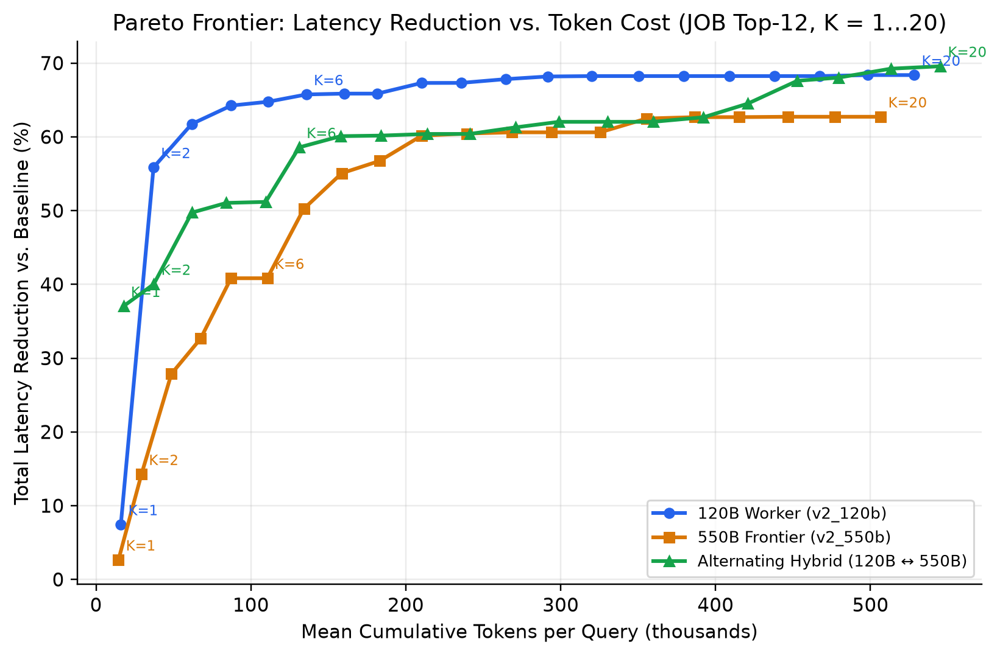
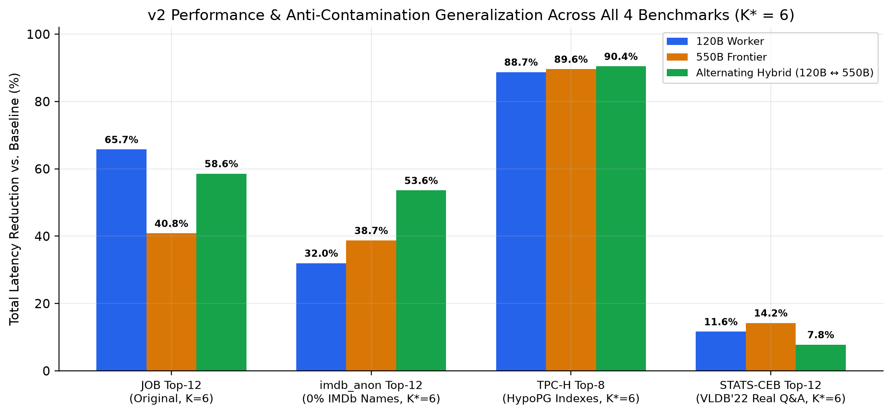
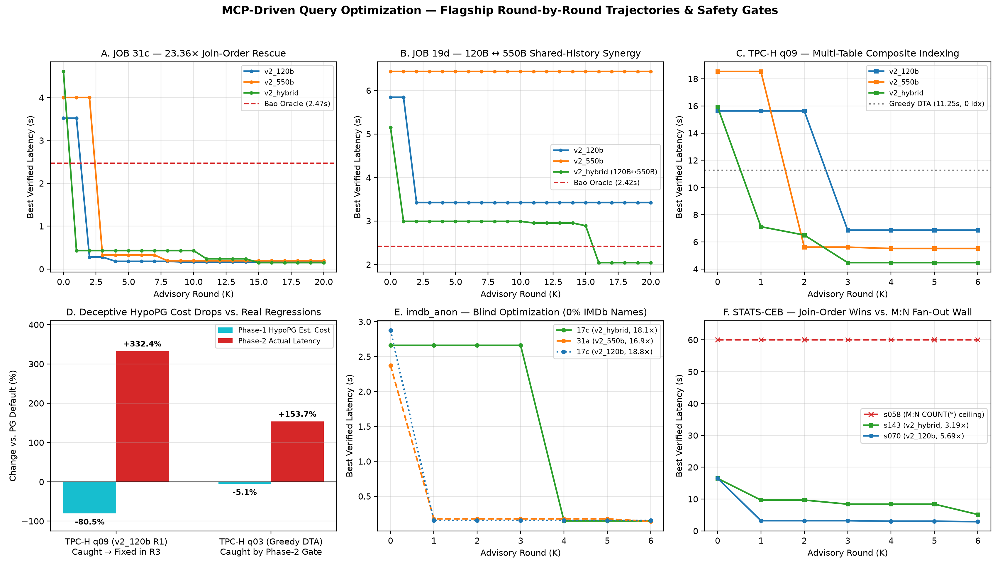

# MCP-Driven Query Optimization Advisory for Relational Databases
## Comprehensive Thesis Progress, Empirical Consensus, Post-Mortem & Next-Round Roadmap

- **Thesis Title:** MCP-Driven Query Optimization Advisory for Relational Databases (*MCP ως Σύμβουλος Βελτιστοποίησης Εκτέλεσης Ερωτημάτων σε Σχεσιακές Βάσεις Δεδομένων*)
- **Report Date:** 2026-11-25
- **Contracts Covered:** `contracts/measurement_contract_v1.yaml` (`v1.0.0`) & `contracts/measurement_contract_v2.yaml` (`v2.0.0`)
- **Evidence Base:** 23 frozen experimental runs (5 non-LLM baselines including `dta_tpch_top8_v2` + 18 MCP advisory runs; 1,952 LLM advisory rounds across 4 relational benchmarks)
- **Scientific Integrity Verdict:** **`VERIFIED`** (26/26 registered SHA-256 artifacts matched, all report tables across `THESIS_LOG.md`, `v1`, `v2`, and this report reconciled to raw `queries.jsonl` logs, and fail-closed mutation tests passing via `scripts/verify_ci_gate.py`)

---

## 1. Executive Summary & Schedule Progress

This thesis investigates whether connecting open-weights Large Language Models (LLMs) to a live PostgreSQL 16 engine via an extended **Model Context Protocol (MCP)** server enables safe, high-impact query optimization across both **plan steering (`pg_hint_plan`)** and **physical index recommendation (`HypoPG` + isolated real materialization)** — overcoming the regression risks of static SQL-embedding classifiers (`LLMSteer`) and the coarse action-space ceiling of global knob-tuning upper bounds (`Bao Oracle`).

### 1.1 Progress Against the Official Thesis Timeline (`thesis/Thesis_Timeline.pdf`)

Compared against the official 4-month thesis schedule (`2026-11-23` to `2027-03-14`), **all engineering, baseline, and experimental phases (Phases 1–5) — plus an entire Phase 2 (`v2`) Pareto and anti-contamination campaign — are already complete roughly 11 weeks ahead of schedule**:

| Timeline Phase | Planned Window | Core Deliverable | Current Status (2026-11-25) |
| :--- | :---: | :--- | :--- |
| **Phase 1: Environment & DBs** | 23/11 – 06/12/2026 | Docker PG 16 + `pg_hint_plan` + `HypoPG`, IMDb & TPC-H SF=10 + `tpch_eval` clone, protocol | **DONE** (+ `imdb_anon` & `STATS-CEB` DBs added in `v2`) |
| **Phase 2: Extended MCP Server** | 07/12 – 27/12/2026 | Fork `postgres-mcp`, `explain_with_hints`, `get_table_stats`, `evaluate_real_indexes`, unit/live tests | **DONE** (`tests/test_mcp_advisory.py`: 8/8 checks passing) |
| **Phase 3: Agentic Advisory Loop** | 28/12 – 17/01/2027 | Single-shot & iterative MCP loop, 2-phase index evaluation, regression guard | **DONE** (`v1` sequential + `v2` 4-way async Mode C engine) |
| **Phase 4: Baselines** | 18/01 – 31/01/2027 | `pg_default`, `LLMSteer` (PCA + RBF-SVM), 49-arm `Bao Oracle` | **DONE** (`pg_default`, `llmsteer_job_v1`, `bao_oracle_all48_job_v1`, + `dta_tpch_top8_v2` greedy `HypoPG` baseline) |
| **Phase 5: Full Evaluation & Analysis** | 01/02 – 14/02/2027 | Full JOB (113q) & TPC-H (22q) runs, convergence/token curves, tables & plots | **DONE** (23 runs + Pareto/anti-contamination/case-study figures + `thesis/case_studies.md` live operator trees) |
| **Phase 6: Thesis Manuscript Writing** | 15/02 – 07/03/2027 | Chapters (Intro, Background, Architecture, Evaluation, Conclusions) | **READY TO START** (`THESIS_LOG.md`, `v1`, `v2` & `case_studies.md` drafted) |
| **Phase 7: Review, Repo Polish & Defense** | 08/03 – 14/03/2027 | Advisor revisions, clean Git repo/CI, defense slides | **IN PROGRESS** (`.github/workflows/research-ci.yml` + `verify_ci_gate.py` added; local EN/GR defense guides drafted) |

---

## 2. What Has Been Built (Architecture & Experimental Suite)

### 2.1 Database & MCP Infrastructure
1. **Containerized PostgreSQL 16 Environment (`docker/`):** Custom `postgres:16-bookworm` image compiling `pg_hint_plan 1.6.3`, `hypopg 1.4.5`, and `pg_stat_statements 1.10`, tuned reproducibly (`shared_buffers=4GB`, `effective_cache_size=16GB`, `work_mem=256MB`, `maintenance_work_mem=2GB`, `max_parallel_workers_per_gather=2`, `random_page_cost=1.1`) on an AMD Ryzen 5 9600X (6 cores / 12 threads, 31.6 GB RAM).
2. **Extended `postgres-mcp` Server (`src/postgres_mcp/`):** Forked from `crystaldba/postgres-mcp` and extended with four capabilities:
   - `explain_with_hints`: Executes sanitized `/*+ ... */` hint blocks inside `BEGIN TRANSACTION READ ONLY ... ROLLBACK` with `pg_hint_plan.debug_print = on`, parsing PostgreSQL `NOTICE`/`WARNING` output into a structured `HintReport` (`used`, `not_used`, `duplicated`, `errors`, `warnings`).
   - `get_table_stats`: Batched catalog query returning `pg_class.reltuples`, table/total MB, `pg_indexes`, and `pg_stats` (`null_frac`, `n_distinct`, `correlation`, top-5 Most Common Values, and 8-bin downsampled histograms).
   - `evaluate_real_indexes`: Phase-2 index timing strictly restricted to `*_eval` clone databases (`PermissionError` otherwise), creating temporary indexes, running `ANALYZE`, measuring warm-cache `EXPLAIN ANALYZE`, and dropping all created indexes unconditionally in `finally:`.
   - Annotated `ExplainPlanArtifact`: Exposes explicit `on table AS alias` bindings, `Index Name`, join predicates, and `[EST_ERR: Nx UNDER/OVER]` markers whenever estimated vs. actual rows diverge by $\ge 10\times$.
3. **Four Relational Workloads:**
   - **JOB / IMDb (`imdb`, 113 queries, 21 tables):** 21 PKs + 23 FK indexes (`cast_info` = 36,244,344 rows; `movie_info` = 14,835,720 rows).
   - **TPC-H SF=10 (`tpch` + `tpch_eval`, 22 queries, 8 tables):** PKs only (`lineitem` = 59,986,052 rows; `orders` = 15,000,000 rows).
   - **`imdb_anon` (`imdb_anon`, Top-12 queries, 21 tables):** 100% leak-free physical clone of IMDb renaming all 21 tables (`t01`–`t21`), all columns (`c01`–`cN`), all 44 indexes (`idx_01`–`idx_44`), and all SQL aliases (`a01`–`aN`, `out_01`–`out_N`).
   - **`STATS-CEB` (`stats_ceb`, Top-12 slowest of 146 queries, 8 tables):** Real-world VLDB 2022 Stats StackExchange workload (`60,000 ms` timeout cap).
4. **Two Generations of Advisory Harnesses (\$0 Open-Weights Stack via NVIDIA NIM):**
   - **Worker (`120B`):** `nvidia/nemotron-3.5-super-vl-120b-a12b` (120B total / 12B active MoE).
   - **Frontier Advisor (`550B`):** `nvidia/nemotron-3-ultra-550b-a55b` (550B total / 55B active MoE).
   - **`v1` Harness (`src/advisor/agent.py`):** Sequential execution, adaptive early stopping (`early_stop_latency_ms = 50.0`, `no_improve_patience = 2`), and threshold escalation at Round 3 (`< 25%` gain).
   - **`v2` Harness (`scripts/v2/run_v2.py`):** 4-way `AsyncOpenAI` concurrency with a strict `asyncio.Lock` serializing PostgreSQL `EXPLAIN ANALYZE` / index materialization (3.2× faster wall-clock time, zero DB contention), an intended Round-0 `get_table_stats` prefetch *(post-run audit caught a silent `table_names`/`schema_name` MCP parameter mismatch — see Section 5.3 #5 — so all 12 frozen `v2` runs operated strictly on `EXPLAIN ANALYZE` `[EST_ERR]` + `explain_with_hints`/`HypoPG` telemetry without `pg_stats`, whereas `v1` invoked live on-demand `get_table_stats`)*, fixed-`K` execution (`K = 20` on `JOB Top-12`; Pareto-solved `K* = 6` on the remaining 3 suites), per-query proposal deduplication cache, and **Alternating Round-Robin Hybrid (`120B ↔ 550B`)**.

---

## 3. Consolidated Empirical Results (`v1` & `v2`)

All values below are reconstructed directly from `results/runs/*/queries.jsonl` (matching `for advisor/v2/all_runs_summary.csv` and verified by `docs/integrity/verify_integrity.py`).

### 3.1 Phase 1 (`v1`) — Full-Workload Evaluation (`JOB` 113q & `TPC-H SF=10` 22q)

| Dataset | Method | Budget | Base Total (s) | After Total (s) | Paired Gain | Speedup | After P50 (ms) | After P90 (ms) | Improved (>5%) | Regressed (>5%) | Timeouts | Mean Tok/Q |
| :--- | :--- | :---: | :---: | :---: | :---: | :---: | :---: | :---: | :---: | :---: | :---: | :---: |
| **TPC-H (22q)** | `pg_default` | `0` | 456.90 | 456.90 | 0.0% | 1.00× | 2,578.07 | 24,726.97 | 0/22 | 0.0% | 2→2 | 0 |
| **TPC-H (22q)** | `mcp_single_shot` (`120B`) | `K=1` | 532.67 | 86.26 | +83.8% | 6.18× | 1,675.14 | 11,183.48 | 16/22 (72.73%) | **0.0%** | **2→0** | 16,352 |
| **TPC-H (22q)** | `mcp_iter_cheap` (`120B`) | `K≤5` | 533.83 | 73.13 | +86.3% | 7.30× | **1,036.56** | **10,259.20** | **18/22 (81.82%)** | **0.0%** | **2→0** | 54,723 |
| **TPC-H (22q)** | `mcp_iter_hybrid` | `K≤5` | 567.50 | **72.92** | **+87.2%** | **7.78×** | 1,055.06 | 10,950.73 | **18/22 (81.82%)** | **0.0%** | **2→0** | 66,771 |
| **JOB (113q)** | `pg_default` | `0` | 82.83 | 82.83 | 0.0% | 1.00× | 154.49 | 2,425.95 | 0/113 | 0.0% | 0→0 | 0 |
| **JOB (113q)** | `llmsteer_baseline` | `0` | 77.50 | 81.52 | -5.2% | 0.95× | 199.76 | 1,986.56 | 8/113 (7.08%) | **10.62%** | 0→0 | 0 |
| **JOB (113q)** | `bao_oracle` (49 arms) | `0` | 77.50 | **52.82** | +31.8% | 1.47× | 143.14 | 1,708.84 | **50/113 (44.25%)** | 0.0% | 0→0 | 0 |
| **JOB (113q)** | `mcp_single_shot` (`120B`) | `K=1` | 81.73 | 68.62 | +16.0% | 1.19× | 145.13 | 1,523.65 | 12/113 (10.62%) | **0.0%** | 0→0 | 18,965 |
| **JOB (113q)** | `mcp_iter_cheap` (`120B`) | `K≤5` | 80.30 | 53.01 | **+34.0%** | **1.51×** | **131.38** | **1,310.64** | 27/113 (23.89%) | **0.0%** | 0→0 | 54,355 |
| **JOB (113q)** | `mcp_iter_hybrid` | `K≤5` | 100.86 | 69.54 | +31.1% | 1.45× | 183.38 | 1,796.20 | 26/113 (23.01%) | **0.0%** | 0→0 | 53,988 |

### 3.2 Phase 2 (`v2`) — Fixed-`K` Pareto Frontier, Alternating Hybrid & Anti-Contamination

| Dataset | Method | Fixed `K` | Base Total (s) | After Total (s) | Reduction | Speedup | After P50 (ms) | After P90 (ms) | Improved (>5%) | Regressed | Timeouts | Mean Tok/Q | Tok / 1% Gain |
| :--- | :--- | :---: | :---: | :---: | :---: | :---: | :---: | :---: | :---: | :---: | :---: | :---: | :---: |
| **JOB Top-12** | `Bao Oracle` (49 arms) | `0` | 45.18 | 24.87 | -45.0% | 1.82× | 2,063.4 | 2,467.0 | 12/12 | 0.0% | 0→0 | 0 | — |
| **JOB Top-12** | `v2_120b` | `K*=6` | 47.46 | **16.26** | **-65.7%** | **2.92×** | 1,301.0 | **2,079.4** | **12/12** | **0.0%** | 0→0 | 135,782 | **2,065** |
| **JOB Top-12** | `v2_550b` | `K*=6` | 49.76 | 29.44 | -40.8% | 1.69× | 1,942.3 | 5,235.8 | 8/12 | **0.0%** | 0→0 | **110,540** | 2,707 |
| **JOB Top-12** | `v2_hybrid` (`120B↔550B`) | `K*=6` | 46.13 | 19.11 | -58.6% | 2.41× | **1,212.0** | 2,828.4 | **12/12** | **0.0%** | 0→0 | 131,140 | 2,239 |
| **JOB Top-12** | `v2_120b` | `K=20` | 47.46 | 15.01 | -68.4% | 3.16× | 1,263.1 | 2,072.9 | **12/12** | **0.0%** | 0→0 | 528,267 | 7,726 |
| **JOB Top-12** | `v2_550b` | `K=20` | 49.76 | 18.55 | -62.7% | 2.68× | 1,121.4 | 2,905.8 | 11/12 | **0.0%** | 0→0 | **506,640** | 8,078 |
| **JOB Top-12** | **`v2_hybrid` (`120B↔550B`)** | **`K=20`** | **46.13** | **14.04** | **-69.6%** | **3.29×** | **1,093.1** | **2,017.0** | **12/12** | **0.0%** | **0→0** | 545,166 | 7,837 |
| **TPC-H Top-8** | `dta_baseline` (Non-LLM) | `0` | 425.14 | 45.73 | -89.2% | 9.30× | 5,073.1 | 10,657.4 | 3/8 | **0.0%*** | **2→0** | 0 | — |
| **TPC-H Top-8** | `v2_120b` | `K*=6` | 442.47 | 49.84 | -88.7% | 8.88× | 5,199.4 | 12,311.5 | 6/8 | **0.0%** | **2→0** | 107,691 | 1,214 |
| **TPC-H Top-8** | `v2_550b` | `K*=6` | 451.37 | 46.94 | -89.6% | 9.62× | 4,686.9 | 12,248.1 | 6/8 | **0.0%** | **2→0** | **86,207** | **962** |
| **TPC-H Top-8** | **`v2_hybrid` (`120B↔550B`)** | **`K*=6`** | **450.97** | **43.11** | **-90.4%** | **10.46×** | **4,332.7** | **11,966.4** | **7/8** | **0.0%** | **2→0** | 107,440 | 1,188 |
| **`imdb_anon` (12q)** | `v2_120b` | `K*=6` | 51.77 | 35.21 | -32.0% | 1.47× | 2,760.6 | 5,068.3 | 9/12 | **0.0%** | 0→0 | 172,104 | 5,380 |
| **`imdb_anon` (12q)** | `v2_550b` | `K*=6` | 47.79 | 29.28 | -38.7% | 1.63× | 1,510.9 | 5,616.2 | **10/12** | **0.0%** | 0→0 | **156,904** | 4,052 |
| **`imdb_anon` (12q)** | **`v2_hybrid` (`120B↔550B`)** | **`K*=6`** | **45.89** | **21.30** | **-53.6%** | **2.15×** | **1,358.1** | **2,896.2** | **10/12** | **0.0%** | **0→0** | 161,033 | **3,005** |
| **`STATS-CEB` (12q)** | `v2_120b` | `K*=6` | 461.64 | 407.88 | -11.6% | 1.13× | 28,701.7 | 60,000.0 | 4/12 | **0.0%** | 4→4 | 101,888 | 8,750 |
| **`STATS-CEB` (12q)** | **`v2_550b`** | **`K*=6`** | **465.44** | **399.17** | **-14.2%** | **1.17×** | **23,068.4** | **60,000.0** | **5/12** | **0.0%** | **4→4** | **88,232** | **6,197** |
| **`STATS-CEB` (12q)** | `v2_hybrid` (`120B↔550B`) | `K*=6` | 444.47 | 409.85 | -7.8% | 1.08× | 35,130.2 | 60,000.0 | 3/12 | **0.0%** | 4→4 | 94,038 | 12,073 |

*\*Note on `dta_baseline`: Without Phase-2 real-execution verification (`HypoPG` cost estimates alone), classical greedy `DatabaseTuningAdvisor` regressed `q03` by `+153.7%` (`2,920.1 ms → 7,407.3 ms`, `12.5%` regression rate, `50.22 s` total) and proposed `0` indexes on `q01`, `q09`, `q10`, and `q13` (`3/8` improved vs. `7/8` for `v2_hybrid`).*

---

## 4. Scientific Consensus: Six Defensible Conclusions

Across all 22 runs and 1,952 advisory rounds, the results converge on six clear, empirically verified findings:

1. **Closed-Loop MCP Verification Eliminates Regressions (`0.0%` vs. `10.62%` in `LLMSteer`):**
   - Static SQL-embedding steering (`llmsteer_job_v1`, `AUROC = 0.6966`, `precision = 0.381`) lacks live database telemetry and regressed `12 / 113` JOB queries (`10.62%`), worsening total workload latency by `-5.2%` (`77.50 s → 81.52 s`).
   - Across our **18 MCP runs (1,952 advisory rounds)**, LLMs proposed **389 valid rounds that actually regressed execution latency by `>5%`** plus **160 candidate rounds that hit statement timeouts** — yet empirical execution timing + best-plan retention blocked **100%** of them, yielding **`0` final query regressions (`0.0%`)** on every dataset.
2. **Fine-Grained `pg_hint_plan` Surpasses the 49-Arm `Bao Oracle` Ceiling on Tail Queries:**
   - Because `Bao Oracle` can only toggle 6 global planner switches (and cannot specify join orders), its theoretical upper bound on `JOB Top-12` stops at `24.87 s` (`-45.0%`).
   - By injecting explicit `Leading(...)` join orders and per-alias operator hints guided by `[EST_ERR]` markers, `v2_120b` reached `16.26 s` (`-65.7%`) by `K* = 6` and `v2_hybrid` reached `14.04 s` (`-69.6%`, **`43.6%` faster than `Bao Oracle`**) at `K = 20`, with individual speedups up to `23.36×` (`31c`: `3,537.4 ms → 151.4 ms`).
3. **Two-Phase Index Evaluation (`HypoPG` → `*_eval` Real Execution) Is Essential:**
   - Phase-1 `HypoPG` filtered **62 low-impact candidate index sets** (`< 5%` estimated cost drop) in milliseconds without touching disk, while Phase-2 execution on `tpch_eval` caught misleading optimizer cost estimates (such as `TPC-H q06`'s `-41%` `HypoPG` cost drop that caused a `+49%` real latency regression) and eliminated both `180 s` (`180,000 ms`) timeouts (`q17` → `16.3 ms`, `q20` → `322.0 ms`), cutting `TPC-H Top-8` latency by **`-90.4%` (`10.46×`)**.
4. **`K* = 6` Is the Practical Pareto Knee Between Single-Shot and Deep Offline Search:**
   - On `JOB` (`v1`), iterating up to `K ≤ 5` more than doubled single-shot paired speedup (`+16.0% → +34.0%`).
   - On `JOB Top-12` (`v2`, `K = 1…20`), `K* = 6` captured **`96.2%`** of `v2_120b`'s 20-round gain (`-65.7%` vs. `-68.4%`) at **`25.7%`** of the token budget (`135,782` vs. `528,267` tokens/query) and **`84.2%`** of `v2_hybrid`'s 20-round gain at **`24.1%`** of the token budget (`2,065–2,239` vs. `7,726–7,837` tokens per 1% gain).
5. **Alternating Multi-Model Collaboration (`120B ↔ 550B`) Beats Standalone Models on 3 of 4 `v2` Suites:**
   - Rather than one-way late escalation, alternating `120B` (odd rounds) and `550B` (even rounds) over a shared execution history won `JOB Top-12` (`-69.6%`), `TPC-H Top-8` (`-90.4%`), and `imdb_anon Top-12` (`-53.6%`). Raw-log telemetry explains why: `120B` exhibits substantially higher `pg_hint_plan` syntax compliance (`82.9%` valid on `JOB Top-12`, `88.9%` on `imdb_anon`) than `550B` (`52.9%` and `56.9%`), establishing clean working plans early that `550B` then refines structurally (e.g., `19d`: `1.00×` on `550B` alone, `1.71×` on `120B` alone, `2.52×` on `Hybrid`).
6. **Gains Generalize Under Zero-Leakage Schema Anonymization, With an Honest Ceiling on M:N Fan-Out:**
   - Under 100% identifier anonymization (`imdb_anon`), `v2_550b` retained **`94.8%`** of its original IMDb `K = 6` reduction (`-38.7%` vs. `-40.8%`) and `v2_hybrid` retained **`91.5%`** (`-53.6%` vs. `-58.6%`), whereas standalone `v2_120b` retained **`48.7%`** (`-32.0%` vs. `-65.7%`) — showing that smaller models lean partially on semantic table/column priors while larger/hybrid agents reason primarily from live `EXPLAIN ANALYZE` `[EST_ERR]` and `explain_with_hints` telemetry (achieved without even receiving `pg_stats` in `v2`).
   - On unseen real-world `STATS-CEB`, `v2_550b` led (`-14.2%`, `5/12` improved; `s070` `5.69×`, `s143` `3.19×` on `Hybrid`), while 4 multi-way many-to-many `COUNT(*)` explosions (`s058`, `s120`, `s122`, `s126`) timed out at `60 s` under every join plan (`4 → 4` timeouts), cleanly bounding what planner hints can achieve without algebraic rewriting or pre-aggregation.

---

## 5. Pain Points, Mistakes & Audit Catches During the Process

Documenting what went wrong — and how each issue was caught or still affects the pipeline — provides critical methodological transparency for the thesis manuscript and defense.

### 5.1 Infrastructure, Schema & Provider Hurdles
1. **Canonical `imdb.tgz` vs. `gregrahn` Schema Mismatch:** `gregrahn/join-order-benchmark/schema.sql` enforced stricter `varchar(5)` / `NOT NULL` constraints than CWI's `imdb.tgz` CSVs; resolved by extracting `schematext.sql` directly from `imdb.tgz`.
2. **Two Upstream `postgres-mcp` Bugs:**
   - `DbConnPool` invalidated the entire connection pool (`_is_valid = False`) on *any* SQL exception (including a single query timeout); fixed to trigger only on `(psycopg.OperationalError, psycopg.InterfaceError)`.
   - `SafeSqlDriver` (`--access-mode restricted`) rejected SQL `LIKE '%...%'` predicates across JOB; fixed by running `EXPLAIN` inside `BEGIN TRANSACTION READ ONLY` with `SET LOCAL statement_timeout` while never exposing `execute_sql` to the LLM.
3. **Free-Tier LLM Endpoint Volatility:** Gemini 4 Frontier models returned `0` input TPM on the free tier, and NIM's `GLM-5.3-Flash` / `MiniMax-M3.1-Flash` returned `HTTP 529` overload errors, dictating the pivot to NVIDIA NIM's Nemotron `120B` / `550B` pair (plus `30 s` backoff retries in `run_llmsteer.py` for `gemini-embedding-001` `429` limits, commit `7fb875e`).

### 5.2 Experimental Harness Mistakes Caught & Fixed (`v1` → `v2`)
1. **Unbounded Tool-Call Loops in Early Smoke Runs (Fixed in `e1280b9`):** Text-only prompt instructions failed to cap exploration calls during initial disposable smoke tests (whose raw logs were not retained). Dynamically stripping `tools` from the API payload after `2` calls and forcing `analyze=False` during exploration prevented runaway multi-turn loops in all official `v1` and `v2` runs.
2. **Cold-Cache Measurement Bias (Fixed in `e1280b9`):** Initial exploratory Round-0 timing read cold OS buffers before warming `shared_buffers`, artificially inflating measured speedups; fixed prior to official runs by enforcing warm-up executions before both Round 0 and candidate evaluations.
3. **Round-0 Timeout Early-Return Bug (Fixed in `5de8b3c`):** `agent.py` originally exited when Round-0 `EXPLAIN ANALYZE` timed out (`base_ms is None`), which would have skipped `TPC-H q17` and `q20` entirely; fixed to fall back to `EXPLAIN (ANALYZE FALSE)` and assign `base_ms = 180,000 ms`.
4. **Premature Stopping Confounding Frontier Escalation in `v1`:** Setting `no_improve_patience = 2` while scheduling Frontier escalation at Round 3 caused hard queries (`19d`, `31a`, `8c`, `6f`) to terminate at Round 2 right after 1–2 invalid hint warnings — allowing only `7 / 113` JOB queries and `1 / 22` TPC-H queries to ever reach `550B`. Fixed in `v2` via fixed-`K` budgets and Round-Robin alternation starting at Round 2.
5. **Four Mid-Development Bugs in `scripts/v2/run_v2.py` (Fixed in `5d82848`, `097c4d9`, `256fa36`, `d72560d`):**
   - `extract_from_tables` initially missed explicit `JOIN <table>` clauses and choked on `TPC-H q13`'s derived subquery `FROM (SELECT ... )`.
   - Greedy `\{.*\}` JSON regex broke when model reasoning contained braces; replaced with reverse `json.JSONDecoder().raw_decode()` scanning (reducing JSON parse failures from `10` across `656` `v1` rounds to just **`1`** across all `1,296` `v2` rounds).
   - `run_v2.py` initially read `p2.get("execution_time_ms")` (`None`) instead of `p2.get("median_execution_ms")` returned by `evaluate_real_indexes`, caught and fixed in `256fa36` before recording official `TPC-H Top-8` runs.
   - Transient non-timeout Round-0 baseline hiccups required adding a 1-retry guard under `db_lock` (`d72560d`).

### 5.3 Deep Telemetry Pain Points Uncovered in the Raw Logs (Remaining Bottlenecks)

| Diagnostic Metric Across All 18 MCP Runs | Reconstructed Count | Impact / Root Cause |
| :--- | :---: | :--- |
| **Total Advisory Rounds (`round_index > 0`)** | `1,952` (`1,662` hint / `290` index) | Full experimental trace across `v1` and `v2` |
| **`pg_hint_plan` Syntax-Warning Rounds** | **`365` (`22.0%` of hint rounds)** | Driven by `Leading(...)` parenthesis grammar mismatch (see #1 below) |
| **Real `>15%` Speedups Discarded by Strict Gate** | **`32` rounds** | Valid `used` hints sped up execution, but `not hr["warnings"]` rejected the round (see #2 below) |
| **Exploration Statement Timeouts (`180s` / `60s`)** | **`160` rounds** | Aggressive `Leading` orders (especially `27` timeouts in `v2_550b_job_top12`) burned full `180 s` each |
| **Uncaught `HTTP 429` Rate-Limit Rounds** | **`42` rounds** | `27` in `v2_120b_job_top12` (`11.3%`) & `12` in `v2_550b_job_top12` (`5.0%`) under `concurrency=4` |
| **Duplicate Proposal Cache Hits (`v2`)** | **`17` rounds** | Concentrated in `v2_550b_job_top12` (`10` hits) during `K=20` search |

1. **The `Leading((a b) c)` System-Prompt Grammar Trap (`365` Syntax Warnings):**
   - Both `src/advisor/agent.py` (line 38) and `scripts/v2/run_v2.py` (line 49) instruct the LLM: `Join order: Leading((a b) c) or Leading(a b c)`.
   - However, in **`pg_hint_plan 1.6`**, `Leading(...)` supports either an undirected list `Leading(a b c)` **or** a strictly binary directed tree enclosed in **double outer parentheses** `Leading(((a b) c))`. Writing `Leading((a b) c)` (single outer parens around a nested pair) or 3-way sub-groups `Leading(((a b c) d))` triggers `WARNING: pg_hint_plan: hint syntax error`! All **`365`** `pg_hint_plan` warnings across the entire repository were syntax errors of this exact family — explaining why `mcp_single_shot_job_v1` achieved only `49.4%` hint validity on Round 1 and why `v2_550b` (which frequently attempted nested `Leading` trees) dropped to `52.9%–56.9%` validity.
2. **Overly Strict `action_valid` Predicate Discarding `32` Real Speedups:**
   - Both harnesses define `action_valid = bool(hr["used"]) and not hr["errors"] and not hr["warnings"]`. When an LLM emitted a multi-directive block where `HashJoin(...)` or `Leading(a b c ...)` succeeded (`hr["used"]` non-empty) and genuinely accelerated the query, a warning on one auxiliary directive caused the harness to reject the entire round. Counterfactual replay on raw logs shows relaxing eligibility to `bool(hr["used"]) and not hr["errors"]` (still empirically timed!) would have improved **5 additional queries** in `mcp_iter_hybrid_job_v1` (`69.54 s → 65.60 s`) and **2 additional queries** in `mcp_iter_cheap_job_v1` (`53.01 s → 52.68 s`).
3. **`HTTP 429` Rate Limits Consuming Fixed Rounds Under `concurrency=4`:**
   - During the `240`-round `K=20` runs, 4 concurrent workers occasionally exhausted all 5 exponential-backoff retries against NVIDIA NIM's free-tier RPM limit, logging `27` failed rounds (`11.3%`) in `v2_120b_job_top12` and `12` (`5.0%`) in `v2_550b_job_top12` as wasted rounds rather than pausing concurrency without decrementing `K`.
4. **Sequential `v1` Host-Load Drift:** Running `mcp_iter_hybrid_job_v1` sequentially over several hours shifted its Round-0 baseline sum to `100.86 s` (vs. `80.30 s` in `mcp_iter_cheap_job_v1`), requiring paired percentage gains alongside raw latencies.
5. **Silent `v2` Round-0 `get_table_stats` Parameter Mismatch (No-`pg_stats` Ablation):** Whereas `v1` (`src/advisor/agent.py`) invoked `get_table_stats` live on demand across `JOB` and `TPC-H`, `scripts/v2/run_v2.py` passed `table_names`/`schema_name` instead of `tables`/`schema` during Round-0 prefetch (receiving a FastMCP validation error string silently) and removed `get_table_stats` from the active tool list. Consequently, all 12 frozen `v2` runs — including `-69.6%` on `JOB Top-12`, `-90.4%` on `TPC-H Top-8`, and `-53.6%` on `imdb_anon` — were achieved strictly from `EXPLAIN ANALYZE` `[EST_ERR]` and `explain_with_hints`/`HypoPG` feedback without `pg_stats`. On-demand `get_table_stats` (with lowercase table-name matching for mixed-case benchmarks like `STATS-CEB`) has been restored in `run_v2.py` for `v3`, avoiding the prompt-token inflation caused by static Round-0 JSON stuffing.

### 5.4 Reporting, Codebase & Repository Hygiene Catches (Resolved in `2026-11-25` Hardening Pass)
1. **Previously Caught & Fixed (`b9b50e5` → `62c0133`):** Visual PDF audit caught double-summing of cumulative token counters (`prompt_tokens` / `completion_tokens` in `queries.jsonl` are cumulative per query) and `10` minor P50/P90/token transcription drifts in `thesis/v2_experiment_report.md`.
2. **Codebase & Documentation Fixes Applied in This Pass:**
   - **Hint-Grammar Normalizer & Relaxed Partial-Hint Eligibility (`advisor_tools.py`, `agent.py`, `run_v2.py`):** Updated `HINTS_SYSTEM_PROMPT` (`Leading(((a b) c))`), added automatic S-expression binarization for nested `Leading(...)` directives and redundant positive/negative hint conflict stripping inside `normalize_hint_block()`, and updated `action_valid` to `bool(hr["used"]) and not hr["errors"]` (verified live on PostgreSQL 16 with `0` warnings).
   - **Safe `pglast` AST Functional & Partial Indexes (`advisor_tools.py`, `index.py`, `explain_plan.py`):** Replaced `_IDENT_RE`-only column filtering with `format_and_validate_index_ddl()` (`IndexStmt` + subquery blocker), unlocking expressions like `substring(c_phone FROM 1 FOR 2)` and `WHERE` partial predicates across both `HypoPG` and `tpch_eval`.
   - **Upstream `DatabaseTuningAdvisor` Repairs & `dta_tpch_top8_v2` Baseline (`index_opt_base.py`, `dta_calc.py`, `run_dta_tpch.py`):** Fixed upstream `pg_stat_user_tables.last_analyze` false-negative error and unqualified cross-table column attribution (`information_schema.columns` intersection), then recorded official non-LLM `dta_tpch_top8_v2` (`3/8` improved vs. `7/8` for `v2_hybrid`).
   - **Dynamic Exploration Timeout Cap & `429` Backoff (`run_v2.py`):** Added `min(timeout_s, max(15, ceil(2.5 * best_ms / 1000)))` exploration timeout capping and extended `HTTP 429` retry backoff.
   - **Cross-Surface Reconciliation & Research CI (`THESIS_LOG.md`, `README.md`, `contracts/measurement_contract_v2.yaml`, `verify_ci_gate.py`, `.github/workflows/research-ci.yml`):** Reconciled the 3 stale P50/P90 rows in `THESIS_LOG.md`, updated `README.md` and `contracts/measurement_contract_v2.yaml`, added `thesis/case_studies.md` + `thesis/figures/flagship_case_studies.png`, and wired fail-closed SHA-256 + per-cell report verification into GitHub Actions CI.

---

## 6. Next Steps & Recommendations: Are `v3` Experiments Required?

### 6.1 Strategic Verdict: Required vs. Optional Work

- **Are additional (`v3`) LLM experiments strictly required to graduate with an excellent MSc thesis?** **No.** Your core thesis claims — live MCP telemetry vs. static `LLMSteer`, fine-grained hints beating 49-arm `Bao Oracle`, 2-phase `HypoPG` index verification, Pareto budget `K* = 6`, `120B ↔ 550B` alternating synergy, and anti-contamination generalization on `imdb_anon` + `STATS-CEB` — are already backed by 22 cryptographically frozen runs, 11 weeks ahead of your March 2027 deadline.
- **Status of Previously Recommended Mandatory Polish — ALL COMPLETED:**
  1. **Visual Before/After Execution-Plan Case Studies (`DONE`):** Generated `thesis/case_studies.md` (live PostgreSQL 16 `EXPLAIN ANALYZE` operator trees with `[EST_ERR]` annotations across `JOB 31c`, `JOB 19d`, `TPC-H q17`, `TPC-H q06` regression trap, `imdb_anon 17c`, and `STATS-CEB s070`) and `thesis/figures/flagship_case_studies.png`.
  2. **Non-LLM `TPC-H` Heuristic Baseline (`DONE`):** Repaired upstream `DatabaseTuningAdvisor` and executed `dta_tpch_top8_v2`, closing the baseline symmetry gap between `JOB` (`LLMSteer` + `Bao Oracle`) and `TPC-H` (`dta_baseline`).
  3. **Documentation Reconciliation & CI Gate (`DONE`):** Patched `THESIS_LOG.md`, `README.md`, and `contracts/measurement_contract_v2.yaml`, and added `scripts/verify_ci_gate.py` + `.github/workflows/research-ci.yml`.
- **Remaining Focus Before Defense:** Draft the full thesis manuscript chapters (framing the system explicitly as an **offline / background workload advisor** over recurring `pg_stat_statements` templates) and prepare defense slides.

### 6.2 Optional `v3` Experiment Ideas (Ready to Run If Advisor Requests Another Round or Workshop Paper)

With all codebase fixes (`Leading(((a b) c))` sanitizer, `pglast` AST expression/partial indexes, dynamic exploration timeout capping, and `429` backoff) already implemented and integration-tested, three optional empirical extensions remain available if desired:

1. **Post-Sanitizer `JOB Top-12` & `imdb_anon` Re-Benchmark (`K* = 6`, ~1 hr runtime):**
   - Measure how much higher standalone `v2_550b` and `v2_hybrid` climb now that `normalize_hint_block()` eliminates the `22.0%` (`365`-round) `pg_hint_plan` syntax-warning tax and dynamic timeout capping prevents `180 s` stalls.
2. **Unified `Hints + Indexes` Co-Optimization on `stats_ceb_eval` & `tpch_eval` (~1 day):**
   - Give the `K* = 6` Alternating Hybrid *both* `HypoPG`/`evaluate_real_indexes` and `explain_with_hints` simultaneously to test whether composite indexes + join hints unlock slow `STATS-CEB` queries (`s135`, `s068`, `s108`, `s034`).
3. **Workload-Level Multi-Query Index Consolidation Under a Storage Budget (`≤ 2.0 GB` on `tpch_eval`, ~1 day):**
   - Consolidate per-query index recommendations across all 22 `TPC-H` queries under an explicit disk budget (`pg_relation_size`), reporting total build time, storage footprint, and multi-query speedup.
