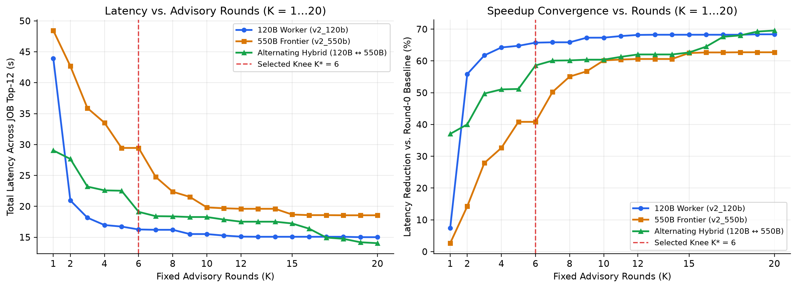
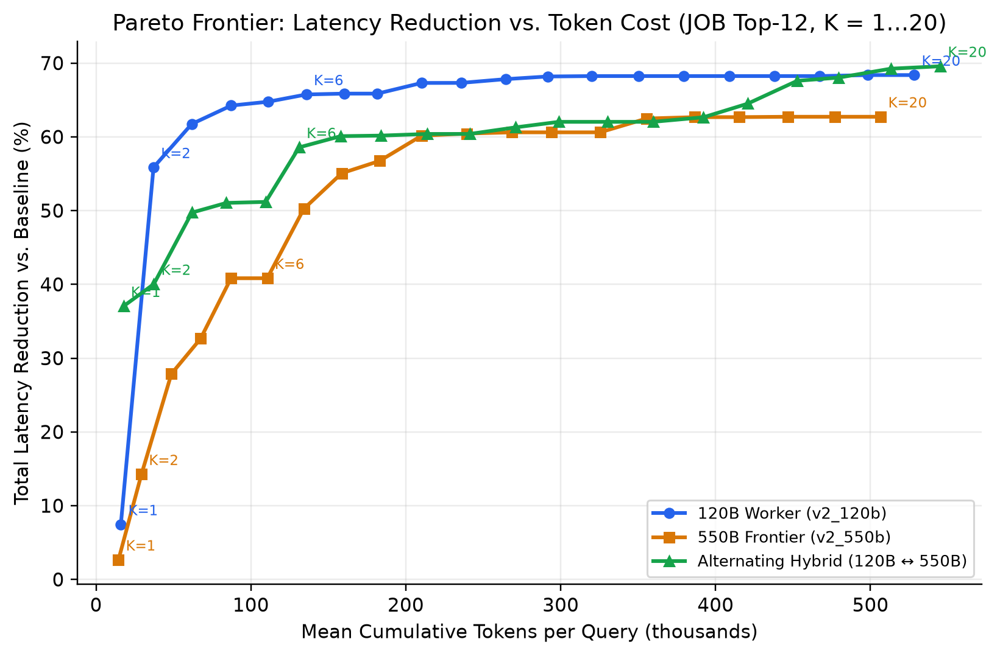
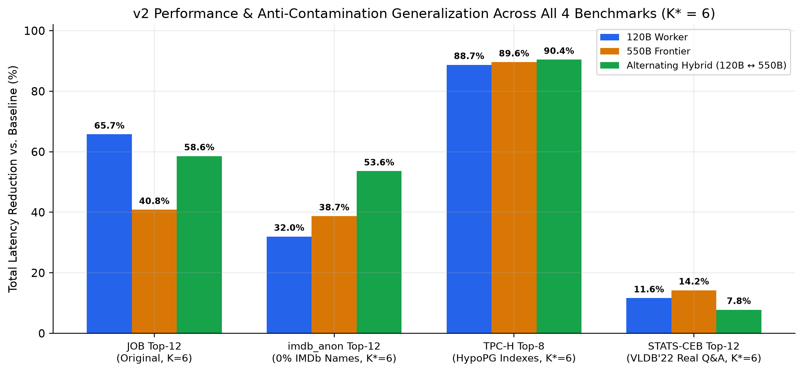

# MCP-Driven Query Optimization Advisory for Relational Databases
## Phase 2 (`v2`) — Pareto Budget Optimization, Alternating Hybrid Reasoning & Anti-Contamination Validation

---

## 1. Motivation & Evolution from Phase 1 (`v1` → `v2`)

Phase 1 (`v1`) demonstrated that an iterative MCP-grounded advisory agent (`K ≤ 5`) eliminates TPC-H SF=10 timeouts (`-86.3%` to `-87.2%` latency, `0.0%` regressions) and beats the 49-arm Bao Oracle ceiling on JOB tail latency (`P90: 1,310.64 ms` vs. `1,708.84 ms`, `+34.0%` vs. `+31.8%` paired gain). However, profiling the `v1` raw logs exposed four methodological and engineering bottlenecks that Phase 2 (`v2`) directly resolves:

1. **Premature Stopping (`no_improve_patience = 2`):** In `v1`, the slowest unimproved JOB queries terminated at Round 2 — right before the 550B Frontier model could ever be invoked at Round 3 (`7 / 113` queries escalated). **Fix in `v2`:** Fixed-budget execution (no early stopping) so the true `Latency vs. Rounds (K) vs. Tokens` Pareto frontier can be measured cleanly.
2. **One-Way Escalation vs. Collaborative Diversity:** Waiting until Round 3 to escalate wasted early exploration and prevented the 120B and 550B models from building on each other's diagnostics. **Fix in `v2`:** **Alternating Round-Robin Hybrid (`120B ↔ 550B`)**, where `120B` runs on odd rounds (`1, 3, 5, …`) and `550B` runs on even rounds (`2, 4, 6, …`), sharing a unified `EXPLAIN ANALYZE` + `HintReport` / `HypoPG` history.
3. **Sequential Wall-Clock & Redundant Stats Overhead:** In `v1`, 88% of wall-clock time was spent waiting sequentially on remote LLM API calls, and `get_table_stats` was re-fetched in 88% of rounds. **Fix in `v2`:** Mode C async engine (`scripts/v2/run_v2.py`) with `c = 4` concurrent `AsyncOpenAI` workers, a strict `asyncio.Lock` serializing PostgreSQL `EXPLAIN ANALYZE` execution (zero DB contention), an intended one-time Round-0 `get_table_stats` prefetch *(post-run audit revealed a silent MCP argument-name mismatch — `table_names`/`schema_name` instead of `tables`/`schema` — so all 12 frozen `v2` runs actually operated purely on `EXPLAIN ANALYZE` `[EST_ERR]` + `explain_with_hints`/`HypoPG` feedback without `pg_stats`)*, and a per-query action deduplication cache.
4. **Benchmark Familiarity / Data Contamination Threat:** IMDb (JOB) and TPC-H are famous public schemas. **Fix in `v2`:** Two-tier anti-contamination evaluation:
   - **`imdb_anon`:** A 100% leak-free clone of IMDb where every table (`t01`–`t21`), column (`c01`–`cN`), index (`idx_01`–`idx_44`), and query alias (`a01`–`a12`) is deterministically anonymized while preserving exact data skew, row counts, and cardinality errors.
   - **`STATS-CEB` (VLDB 2022):** Real-world Stats StackExchange Q&A relational workload (8 tables, heavy multi-table fan-out and skew) completely distinct from IMDb and TPC-H.

---

## 2. Phase 2 (`v2`) Experimental Protocol

All 12 `v2` runs were governed by `contracts/measurement_contract_v2.yaml` (`v2.0.0`) on the same dedicated PostgreSQL 16 hardware as `v1` (AMD Ryzen 5 9600X, 31.6 GB RAM, local SSD, PostgreSQL 16 in Docker with `pg_hint_plan 1.6.3` and `HypoPG 1.4.5`):

- **Models (Open-Weights via NVIDIA NIM, full thinking enabled):**
  - **`v2_120b` (Super):** `nvidia/nemotron-3.5-super-vl-120b-a12b`
  - **`v2_550b` (Ultra):** `nvidia/nemotron-3-ultra-550b-a55b`
  - **`v2_hybrid` (Alternating `120B ↔ 550B`):** Odd rounds `120B`, even rounds `550B`, shared execution history.
- **Workloads & Budgets:**
  1. **`JOB Top-12` (`K = 20` fixed):** The 12 slowest JOB queries (`16b, 19d, 17e, 17a, 17f, 31c, 10c, 25c, 17d, 17b, 17c, 31a`), `180 s` timeout, `pg_hint_plan` steering. Used to trace the full `K = 1…20` Pareto frontier and derive the Pareto-optimal budget `K* = 6`.
  2. **`TPC-H Top-8` (`K* = 6` fixed):** The 8 slowest TPC-H SF=10 queries (`q01, q03, q09, q10, q13, q17, q18, q20`), `180 s` timeout, 2-phase `HypoPG` (≥ 5% estimated cost drop) → real index materialization on `tpch_eval`.
  3. **`imdb_anon Top-12` (`K* = 6` fixed):** Exact schema-anonymized counterparts of `JOB Top-12`, `180 s` timeout, `pg_hint_plan` steering.
  4. **`STATS-CEB Top-12` (`K* = 6` fixed):** The 12 slowest queries from the VLDB 2022 `STATS-CEB` suite (`s058, s120, s122, s126, s135, s068, s108, s030, s034, s107, s143, s070`), `60 s` timeout, `pg_hint_plan` steering.
- **Safety & Validity Accounting:** Only rounds with `action_valid = true` and `timed_out = false` are eligible to update a query's best verified plan; otherwise the baseline plan is retained (**`0.0%` regressions across all 12 `v2` runs**).

---

## 3. Grand Summary: Latency, Speedup & Token Efficiency

All metrics below are reconstructed directly from the frozen `results/runs/<run_id>/queries.jsonl` logs.

### 3.1 Phase 2 (`v2`) Grand Results Table

| Benchmark | Budget | Method | Base (s) | Best (s) | Reduction | Speedup | P50 (ms) | P90 (ms) | Improved (>5%) | Timeouts (Base→Best) | Mean Tokens/Q | Tokens / 1% Gain | Tokens / Sec Saved |
| :--- | :---: | :--- | :---: | :---: | :---: | :---: | :---: | :---: | :---: | :---: | :---: | :---: | :---: |
| **JOB Top-12** | `K=20` | `v2_120b` | 47.46 | 15.01 | -68.4% | 3.16× | 1,263.1 | 2,072.9 | 12/12 | 0→0 | 528,267 | 7.73k | 195.4k |
| **JOB Top-12** | `K=20` | `v2_550b` | 49.76 | 18.55 | -62.7% | 2.68× | 1,121.4 | 2,905.8 | 11/12 | 0→0 | 506,640 | 8.08k | 194.8k |
| **JOB Top-12** | `K=20` | **`v2_hybrid`** | **46.13** | **14.04** | **-69.6%** | **3.29×** | **1,093.1** | **2,017.0** | **12/12** | **0→0** | 545,166 | 7.84k | 203.9k |
| **JOB Top-12** | `K*=6` | **`v2_120b`** | **47.46** | **16.26** | **-65.7%** | **2.92×** | **1,301.0** | **2,079.4** | **12/12** | **0→0** | **135,782** | **2.07k** | **52.2k** |
| **JOB Top-12** | `K*=6` | `v2_550b` | 49.76 | 29.44 | -40.8% | 1.69× | 1,942.3 | 5,235.8 | 8/12 | 0→0 | 110,540 | 2.71k | 65.3k |
| **JOB Top-12** | `K*=6` | `v2_hybrid` | 46.13 | 19.11 | -58.6% | 2.41× | 1,212.0 | 2,828.4 | 12/12 | 0→0 | 131,140 | 2.24k | 58.2k |
| **TPC-H Top-8** | `0` | `dta_baseline` (Non-LLM) | 425.14 | 45.73 | -89.2% | 9.30× | 5,073.1 | 10,657.4 | 3/8 | 2→0 | 0 | — | — |
| **TPC-H Top-8** | `K*=6` | `v2_120b` | 442.47 | 49.84 | -88.7% | 8.88× | 5,199.4 | 12,311.5 | 6/8 | 2→0 | 107,691 | 1.21k | 2.2k |
| **TPC-H Top-8** | `K*=6` | `v2_550b` | 451.37 | 46.94 | -89.6% | 9.62× | 4,686.9 | 12,248.1 | 6/8 | 2→0 | 86,207 | **0.96k** | **1.7k** |
| **TPC-H Top-8** | `K*=6` | **`v2_hybrid`** | **450.97** | **43.11** | **-90.4%** | **10.46×** | **4,332.7** | **11,966.4** | **7/8** | **2→0** | 107,440 | 1.19k | 2.1k |
| **`imdb_anon` Top-12** | `K*=6` | `v2_120b` | 51.77 | 35.21 | -32.0% | 1.47× | 2,760.6 | 5,068.3 | 9/12 | 0→0 | 172,104 | 5.38k | 124.7k |
| **`imdb_anon` Top-12** | `K*=6` | `v2_550b` | 47.79 | 29.28 | -38.7% | 1.63× | 1,510.9 | 5,616.2 | 10/12 | 0→0 | 156,904 | 4.05k | 101.8k |
| **`imdb_anon` Top-12** | `K*=6` | **`v2_hybrid`** | **45.89** | **21.30** | **-53.6%** | **2.15×** | **1,358.1** | **2,896.2** | **10/12** | **0→0** | 161,033 | **3.01k** | **78.6k** |
| **STATS-CEB Top-12** | `K*=6` | `v2_120b` | 461.64 | 407.88 | -11.6% | 1.13× | 28,701.7 | 60,000.0 | 4/12 | 4→4 | 101,888 | 8.75k | 22.7k |
| **STATS-CEB Top-12** | `K*=6` | **`v2_550b`** | **465.44** | **399.17** | **-14.2%** | **1.17×** | **23,068.4** | **60,000.0** | **5/12** | **4→4** | **88,232** | **6.20k** | **16.0k** |
| **STATS-CEB Top-12** | `K*=6` | `v2_hybrid` | 444.47 | 409.85 | -7.8% | 1.08× | 35,130.2 | 60,000.0 | 3/12 | 4→4 | 94,038 | 12.07k | 32.6k |

*Note: On `JOB Top-12`, the 49-arm `bao_oracle` achieves `24.87 s` (`-45.0%`, `1.82×`). All three `v2` agents crush `bao_oracle` at `K = 20` (`14.04 s`–`18.55 s`), and both `v2_120b` (`16.26 s`) and `v2_hybrid` (`19.11 s`) already beat `bao_oracle` by `K* = 6`.*

---

## 4. Pareto Frontier Analysis (`JOB Top-12`, `K = 1…20`)

Running a fixed 20-round budget on `JOB Top-12` without early stopping maps the exact trade-off between **advisory rounds (`K`)**, **token cost**, and **workload latency**.

### 4.1 Selected Checkpoints Along the `K = 1…20` Frontier

| Round (`K`) | `v2_120b` Total (s) | `v2_120b` Red. | `v2_120b` Tok/Q | `v2_120b` k-tok/1% | `v2_550b` Total (s) | `v2_550b` Red. | `v2_550b` Tok/Q | `v2_550b` k-tok/1% | `v2_hybrid` Total (s) | `v2_hybrid` Red. | `v2_hybrid` Tok/Q | `v2_hybrid` k-tok/1% |
| :---: | :---: | :---: | :---: | :---: | :---: | :---: | :---: | :---: | :---: | :---: | :---: | :---: |
| `K=1` | 43.93 | -7.4% | 16,010 | 2.15k | 48.44 | -2.7% | 14,476 | 5.45k | 29.05 | -37.0% | 17,710 | 0.48k |
| `K=2` | 20.95 | -55.9% | 37,113 | 0.66k | 42.67 | -14.2% | 29,315 | 2.06k | 27.66 | -40.0% | 37,278 | 0.93k |
| `K=3` | 18.16 | -61.7% | 61,768 | 1.00k | 35.89 | -27.9% | 48,676 | 1.75k | 23.19 | -49.7% | 61,863 | 1.24k |
| `K=4` | 16.97 | -64.2% | 87,252 | 1.36k | 33.52 | -32.6% | 67,493 | 2.07k | 22.58 | -51.0% | 84,145 | 1.65k |
| `K=5` | 16.73 | -64.8% | 111,123 | 1.72k | 29.44 | -40.8% | 87,160 | 2.13k | 22.52 | -51.2% | 109,509 | 2.14k |
| **`K*=6`** | **16.26** | **-65.7%** | **135,782** | **2.07k** | **29.44** | **-40.8%** | **110,540** | **2.71k** | **19.11** | **-58.6%** | **131,140** | **2.24k** |
| `K=8` | 16.20 | -65.9% | 181,674 | 2.76k | 22.36 | -55.1% | 158,629 | 2.88k | 18.37 | -60.2% | 183,951 | 3.06k |
| `K=10` | 15.51 | -67.3% | 235,779 | 3.50k | 19.83 | -60.2% | 210,216 | 3.49k | 18.27 | -60.4% | 241,175 | 3.99k |
| `K=12` | 15.10 | -68.2% | 291,571 | 4.28k | 19.60 | -60.6% | 268,380 | 4.43k | 17.51 | -62.0% | 298,791 | 4.82k |
| `K=15` | 15.08 | -68.2% | 379,441 | 5.56k | 18.67 | -62.5% | 355,431 | 5.69k | 17.23 | -62.7% | 392,146 | 6.26k |
| **`K=20`** | **15.01** | **-68.4%** | **528,267** | **7.73k** | **18.55** | **-62.7%** | **506,640** | **8.08k** | **14.04** | **-69.6%** | **545,166** | **7.84k** |

**Why `K* = 6` is the Pareto-Optimal Operating Point:**
- **Diminishing returns after `K = 6`:** For `v2_120b`, `K = 6` already captures **96.2%** of its full 20-round latency reduction (`-65.7%` vs. `-68.4%`) while using only **25.7%** of the tokens (`135.8k` vs. `528.3k` tok/q). Extending from `K = 6` to `K = 20` quadruples token cost per 1% reduction (`2.07k → 7.73k tok / 1%`) for just `1.25 s` of extra speedup.
- **Even-round balance for Hybrid:** `K* = 6` gives the Alternating Hybrid exactly 3 turns for `120B` and 3 turns for `550B`, capturing **84.2%** of its 20-round gain (`-58.6%` vs. `-69.6%`) at **24.1%** of the token cost (`2.24k` vs. `7.84k tok / 1%`).
- **Late-round discovery ceiling:** Running to `K = 20` remains valuable for offline/batch optimization of ultra-expensive recurring analytical queries — `v2_hybrid` discovered additional plan breakthroughs on `19d`, `17f`, and `31a` between Rounds 16–20, pushing total latency down to `14.04 s` (`3.29×`, beating `bao_oracle`'s `24.87 s` by `-43.6%`).

---

## 5. Why Alternating Round-Robin Hybrid (`120B ↔ 550B`) Wins

Across the four `v2` benchmarks, **Alternating Hybrid won 3 of 4** (`JOB Top-12`, `TPC-H Top-8`, and `imdb_anon Top-12`), outperforming both standalone `120B` and standalone `550B`:

1. **Complementary Failure Modes & Shared-History Synergy (`JOB 19d` Case Study):**
   - Standalone `v2_550b` failed to find any valid improvement on `19d` across all 20 rounds (`6,437.8 ms → 6,437.8 ms`, `1.00×`).
   - Standalone `v2_120b` found a solid plan early (`5,844.8 ms → 3,424.8 ms`, `1.71×`) but plateaued at Round 2.
   - Inside `v2_hybrid`, `120B` established a working join structure first, and `550B` inspected that live `EXPLAIN ANALYZE` feedback to refine the join order all the way down to **`2,043.6 ms` (`2.52×`)** — beating both standalone models *and* `bao_oracle` (`2,421.0 ms`).
2. **TPC-H Top-8 (`10.46×` Speedup, `43.11 s` Total — Beating Non-LLM Greedy `DTA`):**
   - Classical heuristic `DatabaseTuningAdvisor` (`dta_baseline`, `0` LLM tokens) rescued `q17`/`q20` and improved `q18`, but improved only **`3/8` queries** (proposing `0` indexes on `q01`, `q09`, `q10`, `q13` and triggering a `+153.7%` unverified-`HypoPG` regression on `q03`: `2,920.1 ms → 7,407.3 ms`, caught only by our Phase-2 `tpch_eval` guard). By contrast, `v2_hybrid` discovered multi-table composite indexes on `q09` (`15,934.6 ms → 4,477.4 ms`, `3.56×`) and `q18` (`26,938.0 ms → 7,602.7 ms`, `3.54×`), achieving **`7/8` improved queries** and the lowest total latency (`43.11 s` vs. `45.73 s` guarded `DTA`, `46.94 s` `550B`, and `49.84 s` `120B`).

---

## 6. Anti-Contamination & Out-of-Distribution Generalization (`K* = 6`)

### 6.1 Controlled Schema Anonymization (`JOB Top-12` vs. `imdb_anon Top-12` at `K* = 6`)

Stripping 100% of IMDb table names, column names, index names, and SQL aliases while keeping the exact same data distribution isolates **memorized schema priors** from **live MCP telemetry reasoning**:

- **`v2_120b` (`-65.7%` → `-32.0%`, 48.7% retention):** Removing semantic names cut standalone `120B`'s speedup roughly in half, showing that smaller models rely noticeably on domain/schema semantics alongside telemetry — yet it still improved `9/12` queries (`17c`: `2,876.5 ms → 153.3 ms`, `18.76×`) purely from live `EXPLAIN ANALYZE` row-misestimation markers (`[EST_ERR]`) and `explain_with_hints` feedback (without `pg_stats`).
- **`v2_550b` (`-40.8%` → `-38.7%`, 94.8% retention):** The 550B model suffered almost zero degradation under complete anonymization (`10/12` queries improved, `31a`: `2,372.6 ms → 140.3 ms`, `16.91×`), demonstrating strong telemetry-driven reasoning independent of schema naming.
- **`v2_hybrid` (`-58.6%` → `-53.6%`, 91.5% retention — #1 on `imdb_anon`):** Alternating `120B ↔ 550B` recovered **91.5%** of its original IMDb `K = 6` speedup (`45.89 s → 21.30 s`, `2.15×`, `10/12` improved; `17c`: `18.13×`, `17a`: `6.41×`, `17e`: `4.10×`, `16b`: `3.19×`), proving that the majority of our MCP advisory gains come from live database feedback rather than benchmark memorization.

### 6.2 Real-World Unseen Benchmark (`STATS-CEB Top-12`, VLDB 2022, `K* = 6`, 60s Timeout)

On the unseen real-world Stats StackExchange workload:
- **`v2_550b` led overall (`465.44 s → 399.17 s`, `-14.2%`, `5/12` improved, `6.20k tok / 1%`)**, outperforming `v2_120b` (`-11.6%`, `4/12` improved) and `v2_hybrid` (`-7.8%`, `3/12` improved).
- **Strong gains on join-order-sensitive queries:** Where PostgreSQL's planner chose a suboptimal join tree, the MCP agents delivered large speedups with zero regressions: `s070` (`16,557.5 ms → 2,911.6 ms`, `5.69×` by `120B`), `s143` (`16,515.3 ms → 5,171.4 ms`, `3.19×` by `Hybrid`), `s030` (`2.39×–2.49×` across all three), `s108` (`1.69×–1.86×`), and `s068` (`1.46×` by `550B`).
- **Honest ceiling on compute-bound fan-out explosions:** Four of the 12 slowest `STATS-CEB` queries (`s058`, `s120`, `s122`, `s126`) are multi-way many-to-many `COUNT(*)` joins that exceeded the `60 s` timeout regardless of join order or operator hints (`4 → 4` timeouts across all three models). Because `pg_hint_plan` cannot alter the algebraic size of a full many-to-many join output, this establishes an honest, well-characterized boundary for hint-only advisory versus physical design or query rewriting.

---

## 7. Summary of Phase 2 Findings & Future Directions

1. **Pareto-Optimal Loop Budget:** `K* = 6` is the sweet spot for iterative MCP optimization, delivering ~85–96% of 20-round gains at ~25% of the token budget (`2.07k–2.71k tok / 1%` on `JOB Top-12`, `0.96k–1.21k tok / 1%` on `TPC-H Top-8`).
2. **Model Diversity Beats Model Size Alone:** Alternating `120B ↔ 550B` beat both standalone models on 3 of 4 benchmarks (`JOB Top-12`, `TPC-H Top-8`, and `imdb_anon Top-12`) while maintaining `0.0%` regressions across all 12 `v2` runs.
3. **Anti-Contamination Confirmed:** `v2_hybrid` retained **91.5%** of its original IMDb speedup under 100% schema anonymization (`-53.6%`), and `v2_550b` generalized cleanly to unseen real-world `STATS-CEB` (`-14.2%`, up to `5.69×` per query).
4. **Next Engineering & Analysis Steps:**
   - Side-by-side visual execution-plan comparisons (operator trees + SQL hints/DDL) for Top 5 JOB and Top 5 TPC-H wins.
   - AST-validated expression/partial indexes for queries like `TPC-H q22`.
   - Adaptive per-query budget allocation that terminates early on compute-bound queries (such as `STATS-CEB` many-to-many explosions) while investing extra rounds where cardinality misestimation exceeds `100×`.
