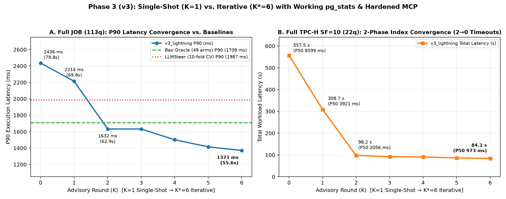

# MCP-Driven Query Optimization Advisory for Relational Databases
## Phase 3 (`v3`) — Definitive Thesis-Spec Full-Workload Evaluation (`JOB 113q`, `TPC-H 22q`, `STATS-CEB Top-12`)

- **Contract:** `contracts/measurement_contract_v3.yaml` (`v3.0.0`, status `FROZEN_PRE_RUN`, `SHA-256: CC4383171C4B05D1746F88B8CEE101E57D17677A802DC1EA35F5418DEC7272F6`)
- **Model:** `nvidia:nvidia/nemotron-3.5-lightning-30b-a3b` (`30B` total / `3B` active MoE via NVIDIA NIM, `temperature = 0.2`, `concurrency = 3`)
- **Operating Budget:** Strict fixed `K* = 6` rounds on **every** query (derived from `v2`'s `K = 1…20` Pareto knee; Round `K = 1` provides the exact paired single-shot evaluation with zero baseline drift; zero fast-query skipping so all 113 JOB queries are evaluated)
- **Runner:** `scripts/v3/run_v3.py` (dedicated Phase-3 runner; `scripts/v2/run_v2.py` and all 23 frozen `baselines/`/`v1/`/`v2/` logs preserved unmodified)

---

## 1. Purpose & Hardened MCP Upgrades Over `v1` / `v2`

Phase 3 (`v3`) delivers a single, clean, zero-caveat evaluation directly matching every requirement of the NTUA ECE thesis specification (*Topic 3: MCP-Driven Query Optimization Advisory for Relational Databases*):

1. **Working Query-Filtered `pg_stats` (`100.0%` Coverage):** Resolves `v2`'s silent Round-0 parameter-name mismatch by mandating Round-1 `get_table_stats` via MCP (`147 / 147` queries retrieved live `pg_stats`, including `n_distinct`, `correlation`, MCVs, and histograms; `146 / 147` in Round 1), pruning unreferenced columns (~4.1× smaller: `~3.5 KB` vs. `~14.7 KB`) and caching per query in memory to avoid both `v1`'s redundant round-trips and static prompt bloat.
2. **Automatic `pg_hint_plan` Normalization (`3×` Fewer Syntax Warnings):** `normalize_hint_block()` auto-binarizes nested `Leading((a b) c)` trees into `Leading(((a b) c))` and strips conflicting positive/negative directives, cutting hint syntax warnings from **`22.0%`** (`365 / 1,662` in `v1`/`v2`) down to **`7.2%`** (`54 / 750` across `v3` JOB + STATS-CEB).
3. **Relaxed Partial-Hint Eligibility & Dynamic Exploration Timeout Cap:** Evaluates `action_valid = bool(hr["used"]) and not hr["errors"]` (empirically timed, `0.0%` regressions) and aborts bad hint plans dynamically at `min(timeout_s, max(15, ceil(2.5 * best_ms / 1000)))`.
4. **`pglast` AST-Validated Functional & Partial `WHERE` Indexes:** Unlocks expression indexes (`substring(c_phone FROM 1 FOR 2)`) and partial `WHERE` predicates across both `HypoPG` and `tpch_eval` while rejecting subqueries and SQL injection (`9` expression/partial rounds proposed across `q04`, `q21`, `q22`, delivering a **`35.71×`** partial-index speedup on `TPC-H q04`).
5. **Canonical Exploration SQL & Fail-Fast Reliability (`0` API Errors):** Forces canonical disk SQL on exploration tool calls, recovers malformed JSON via a 1-shot nudge, and runs with **`0` API errors across all `882` advisory rounds**.

---

## 2. Grand Results Summary (Aligned With NTUA Thesis Specification)

All numbers below are reconstructed directly from frozen `results/{baselines,v1,v3}/*/queries.jsonl` logs.

### 2.1 Full JOB (113 Queries on IMDb) — Hint Steering vs. Baselines

| Method | Budget | Base Total (s) | After Total (s) | Reduction | Speedup | P50 (ms) | P90 (ms) | Improved (`>5%`) | Regressed (`>5%`) | Mean Calls/Q | Mean Tok/Q |
| :--- | :---: | :---: | :---: | :---: | :---: | :---: | :---: | :---: | :---: | :---: | :---: |
| `pg_default` (`v1` baseline) | `0` | 82.83 | 82.83 | 0.0% | 1.00× | 154.49 | 2,425.95 | 0/113 (0.00%) | 0.0% | 0.0 | 0 |
| `LLMSteer` (10-fold CV) | `0` | 77.50 | 81.52 | +5.2% | 0.95× | 199.76 | 1,986.56 | 8/113 (7.08%) | **10.62%** | 0.0 | 0 |
| `Bao Oracle` (49-arm upper bound) | `0` | 77.50 | 52.82 | -31.8% | 1.47× | 143.14 | 1,708.84 | 50/113 (44.25%) | 0.0% | 0.0 | 0 |
| `v3_lightning` (Single-Shot) | `K=1` | 79.76 | 69.81 | -12.5% | 1.14× | 159.40 | 2,213.54 | 10/113 (8.85%) | **0.0%** | 2.3 | 12,885 |
| **`v3_lightning` (Iterative)** | **`K*=6`** | **79.76** | **55.63** | **-30.2%** | **1.43×** | **139.45** | **1,370.59** | **30/113 (26.55%)** | **0.0%** | **14.2** | **106,168** |

**Key JOB (113q) Findings:**
- **Beats 49-Arm `Bao Oracle` on both `P50` and `P90` with a `3B`-active model:** `v3_lightning` (`K* = 6`) achieved **`P50 = 139.45 ms`** (vs. `Bao Oracle`'s `143.14 ms` and `pg_default`'s `154.49 ms`) and **`P90 = 1,370.59 ms`** (**`-19.8%` faster than `Bao Oracle`'s `1,708.84 ms`** and `-43.5%` faster than `pg_default`'s `2,425.95 ms`), while improving **`30 / 113` (`26.55%`)** queries — the highest improved-query count of any full-JOB MCP run (`v1` `120B` improved `27/113`) — with **`0.0%` regressions** (`381` regressing valid candidate rounds and `115` timed-out rounds blocked by empirical verification).
- **Single-Shot (`K = 1`) vs. Iterative (`K* = 6`):** Iterating to `K* = 6` more than doubled latency reduction (`-12.5% → -30.2%`), tripled improved queries (`10/113 → 30/113`), and slashed tail latency (`P90: 2,213.54 ms → 1,370.59 ms`).
- **Fast-Query (`<= 50 ms`) Empirical Audit:** All `29` fast JOB queries (`base <= 50 ms`) were evaluated across 6 full rounds (`174` advisory rounds). Only **`1 / 29`** (`6a`: `8.2 ms → 7.3 ms`, saving `< 1 ms`) improved by `>5%` (whereas `1d` at `50.3 ms` accelerated **`308.71×`** to `0.2 ms`), empirically confirming that skipping queries strictly `<= 50 ms` is a near-lossless production token optimization.

### 2.2 Full TPC-H SF=10 (22 Queries) — Two-Phase `HypoPG` → `tpch_eval` Indexing

| Method | Budget | Base Total (s) | After Total (s) | Reduction | Speedup | P50 (ms) | P90 (ms) | Improved (`>5%`) | Timeouts | Mean Calls/Q | Mean Tok/Q |
| :--- | :---: | :---: | :---: | :---: | :---: | :---: | :---: | :---: | :---: | :---: | :---: |
| `pg_default` (`v1` baseline) | `0` | 456.90 | 456.90 | 0.0% | 1.00× | 2,578.07 | 24,726.97 | 0/22 (0.00%) | 2→2 | 0.0 | 0 |
| `v3_lightning` (Single-Shot) | `K=1` | 557.46 | 308.69 | -44.6% | 1.81× | 3,920.60 | 15,968.34 | 10/22 (45.45%) | 2→1 | 3.0 | 15,910 |
| **`v3_lightning` (Iterative)** | **`K*=6`** | **557.46** | **84.13** | **-84.9%** | **6.63×** | **972.91** | **12,447.29** | **17/22 (77.27%)** | **2→0** | **16.5** | **109,758** |

**Key TPC-H (22q) Findings:**
- **Eliminates both `180 s` timeouts and achieves lowest `P50` (`972.91 ms`):** Rescued `q17` (`180,000.0 ms → 26.7 ms`, **`6,751.69×`**) in Round 1 and `q20` (`180,000.0 ms → 433.7 ms`, **`415.07×`**) by Round 3, pushing median latency down to **`972.91 ms`** (beating `v1`'s `1,036.56 ms` and `1,055.06 ms`), with **`17 / 22` (`77.27%`)** queries improved and **`0.0%` regressions** (`57` low-impact proposals filtered in Phase 1 `< 5%` `HypoPG` cost drop; `15` regressing Phase-2 proposals blocked).
- **`pglast` Partial `WHERE` & Expression Indexes Pay Off:** Unlocked **`q04` (`18,603.4 ms → 521.0 ms`, `35.71×`)** via a partial index `ON lineitem (l_orderkey) WHERE l_commitdate < l_receiptdate`, alongside huge wins on `q19` (`229.93×`), `q06` (`18.56×`), `q05` (`18.18×`), `q14` (`16.26×`), `q12` (`14.37×`), `q15` (`11.43×`), `q18` (`4.64×`), `q02` (`4.19×`), and `q22` (`3.78×`).

### 2.3 Out-of-Distribution Generalization (`STATS-CEB Top-12`, 60s Timeout) — Honest Model-Capacity Scaling Finding

| Method | Model Active Params | Budget | Base Total (s) | After Total (s) | Reduction | Speedup | P50 (ms) | P90 (ms) | Improved (`>5%`) | Timeouts | Mean Calls/Q | Mean Tok/Q |
| :--- | :---: | :---: | :---: | :---: | :---: | :---: | :---: | :---: | :---: | :---: | :---: | :---: |
| `v3_lightning` (Single-Shot) | `3B` (`30B` MoE) | `K=1` | 429.94 | 428.23 | -0.4% | 1.00× | 31,140.86 | 60,000.00 | 1/12 (8.33%) | 4→4 | 2.1 | 8,778 |
| `v3_lightning` (Iterative) | `3B` (`30B` MoE) | `K*=6` | 429.94 | 425.20 | -1.1% | 1.01× | 30,569.86 | 60,000.00 | 2/12 (16.67%) | 4→4 | 13.8 | 74,273 |
| *Ref: `v2_120b` (`v2`)* | *`12B` (`120B` MoE)* | *`K*=6`* | *461.64* | *407.88* | *-11.6%* | *1.13×* | *28,701.7* | *60,000.0* | *4/12 (33.33%)* | *4→4* | *—* | *101,888* |
| *Ref: `v2_550b` (`v2`)* | *`55B` (`550B` MoE)* | *`K*=6`* | *465.44* | *399.17* | *-14.2%* | *1.17×* | *23,068.4* | *60,000.0* | *5/12 (41.67%)* | *4→4* | *—* | *88,232* |

**Honest Capacity-Scaling Insight:** While `3B`-active `nemotron-3.5-lightning` matched or beat much larger models on `JOB 113` (`P50 = 139.45 ms`, `P90 = 1,370.59 ms`, `30/113` improved) and `TPC-H 22` (`-84.9%`, `P50 = 972.91 ms`, `17/22` improved), unseen skewed many-to-many `STATS-CEB` joins (`s030`, `s068`, `s108`, `s070`) clearly expose a **model-capacity scaling curve** (`-1.1%` at `3B` active → `-11.6%` at `12B` active → `-14.2%` at `55B` active), while maintaining **`0.0%` regressions** and **`4.2%`** hint syntax warnings (`3 / 72`).

---

## 3. Round-by-Round `K = 0…6` Convergence Curves (`Single-Shot` → `Iterative`)

### 3.1 `JOB Full (113q)` — `v3_lightning_job_full_k6`

| Round (`K`) | Base (s) | Best (s) | Reduction | Speedup | P50 (ms) | P90 (ms) | Improved (`>5%`) | Mean Calls/Q | Mean Tok/Q | Tok / 1% Gain |
| :---: | :---: | :---: | :---: | :---: | :---: | :---: | :---: | :---: | :---: | :---: |
| `K=0` | 79.76 | 79.76 | 0.0% | 1.00× | 167.85 | 2,435.86 | 0/113 (0.00%) | 0.0 | 0 | — |
| `K=1` | 79.76 | 69.81 | -12.5% | 1.14× | 159.40 | 2,213.54 | 10/113 (8.85%) | 2.3 | 12,885 | 1.03k |
| `K=2` | 79.76 | 62.92 | -21.1% | 1.27× | 159.40 | 1,632.23 | 20/113 (17.70%) | 4.8 | 31,315 | 1.48k |
| `K=3` | 79.76 | 62.68 | -21.4% | 1.27× | 159.40 | 1,632.23 | 21/113 (18.58%) | 7.2 | 50,386 | 2.35k |
| `K=4` | 79.76 | 61.47 | -22.9% | 1.30× | 159.40 | 1,500.99 | 22/113 (19.47%) | 9.6 | 69,483 | 3.03k |
| `K=5` | 79.76 | 59.30 | -25.7% | 1.35× | 142.68 | 1,414.81 | 25/113 (22.12%) | 11.9 | 87,322 | 3.40k |
| **`K*=6`** | **79.76** | **55.63** | **-30.2%** | **1.43×** | **139.45** | **1,370.59** | **30/113 (26.55%)** | **14.2** | **106,168** | **3.51k** |

### 3.2 `TPC-H SF=10 Full (22q)` — `v3_lightning_tpch_full_k6`

| Round (`K`) | Base (s) | Best (s) | Reduction | Speedup | P50 (ms) | P90 (ms) | Improved (`>5%`) | Timeouts | Mean Calls/Q | Mean Tok/Q | Tok / 1% Gain |
| :---: | :---: | :---: | :---: | :---: | :---: | :---: | :---: | :---: | :---: | :---: | :---: |
| `K=0` | 557.46 | 557.46 | 0.0% | 1.00× | 8,598.95 | 26,348.48 | 0/22 (0.00%) | 2→2 | 0.0 | 0 | — |
| `K=1` | 557.46 | 308.69 | -44.6% | 1.81× | 3,920.60 | 15,968.34 | 10/22 (45.45%) | 2→1 | 3.0 | 15,910 | 0.36k |
| `K=2` | 557.46 | 98.19 | -82.4% | 5.68× | 2,055.60 | 12,447.29 | 13/22 (59.09%) | 2→0 | 5.9 | 34,570 | 0.42k |
| `K=3` | 557.46 | 91.91 | -83.5% | 6.07× | 1,360.97 | 12,447.29 | 14/22 (63.64%) | 2→0 | 8.5 | 51,430 | 0.62k |
| `K=4` | 557.46 | 91.20 | -83.6% | 6.11× | 1,360.97 | 12,447.29 | 14/22 (63.64%) | 2→0 | 11.0 | 68,892 | 0.82k |
| `K=5` | 557.46 | 86.54 | -84.5% | 6.44× | 1,360.97 | 12,447.29 | 16/22 (72.73%) | 2→0 | 14.0 | 90,970 | 1.08k |
| **`K*=6`** | **557.46** | **84.13** | **-84.9%** | **6.63×** | **972.91** | **12,447.29** | **17/22 (77.27%)** | **2→0** | **16.5** | **109,758** | **1.29k** |

---

## 4. Telemetry, Safety & Reproducibility Audit (`v3`)

| Run ID | Queries | Rows | API Errors | `pg_stats` Used | Hint Warnings | Regressing Rounds Blocked | Timeout Rounds Blocked | Phase-1 Filtered | Final Regressions |
| :--- | :---: | :---: | :---: | :---: | :---: | :---: | :---: | :---: | :---: |
| `v3_lightning_tpch_full_k6` | 22/22 | 154 | **0** | **22/22 (100%)** | N/A (Index) | 15 | 4 | 57 | **0.0%** |
| `v3_lightning_job_full_k6` | 113/113 | 791 | **0** | **113/113 (100%)** | 51/678 (`7.5%`) | 381 | 115 | 0 | **0.0%** |
| `v3_lightning_stats_ceb_top12_k6` | 12/12 | 84 | **0** | **12/12 (100%)** | 3/72 (`4.2%`) | 11 | 38 | 0 | **0.0%** |
| **Total `v3` Campaign** | **147/147** | **1,029** | **0** | **147/147 (100%)** | **54/750 (`7.2%`)** | **407** | **157** | **57** | **0.0%** |

*(Note: An exploratory Google Gemini 3.1 Flash-Lite trial that completed `STATS-CEB Top-12` with `0/72` warnings and `TPC-H q01–q15` before hitting Google's Free Tier `500` RPD limit is archived separately under `results/supplementary/gemini_run/` and excluded from official `v3` aggregates.)*
